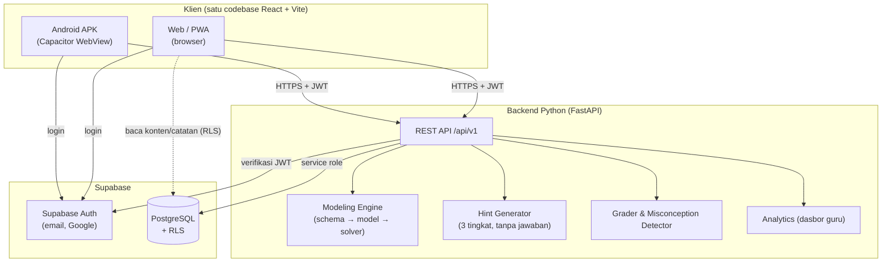
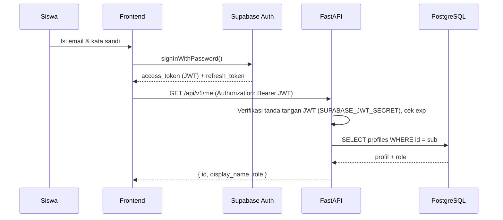
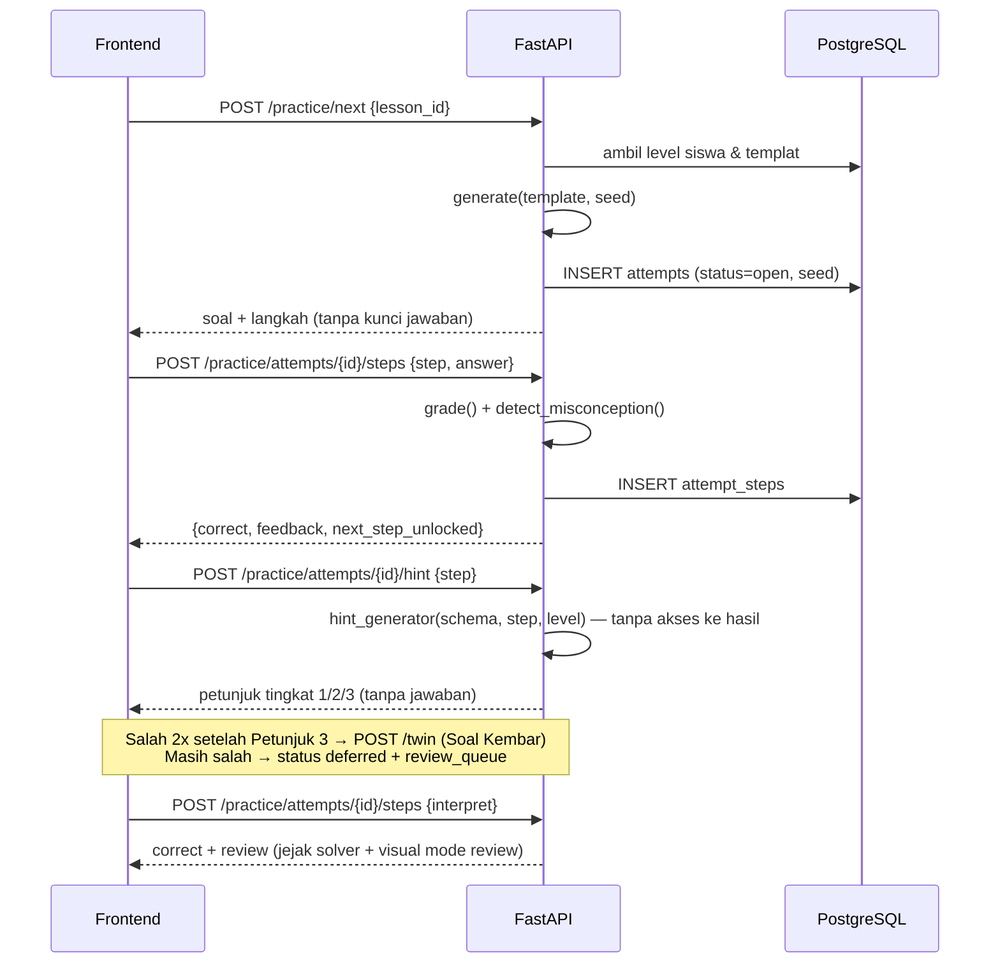

# Arsitektur Sistem — Z-Math

## 1. Gambaran Umum



### Pembagian Tanggung Jawab

| Komponen | Tanggung jawab | Alasan |
|---|---|---|
| **Frontend (React)** | UI, garis bilangan interaktif, alur pelajaran, cache offline | Satu codebase untuk web + Android |
| **Supabase Auth** | Registrasi, login, sesi, token JWT | Tidak perlu membangun sistem auth sendiri |
| **Supabase DB (akses langsung dari klien)** | Operasi CRUD sederhana yang dilindungi RLS: membaca konten, catatan pribadi | Mengurangi beban backend |
| **FastAPI** | Logika yang harus tepercaya atau kompleks: membuat soal, menilai jawaban, mendeteksi miskonsepsi, menghitung progres, analitik guru | Kunci jawaban tidak dikirim ke klien; logika Python mudah diuji |

> **Aturan:** jawaban soal latihan **tidak pernah** dikirim ke klien sebelum siswa menjawab benar. Ini berlaku juga untuk petunjuk dan Soal Kembar. Penilaian selalu dilakukan di backend. Pembahasan (`review`) hanya dikirim setelah status `correct`.

## 2. Struktur Monorepo

```
bulatku/
├── frontend/
│   ├── src/
│   │   ├── app/                 # App.tsx, router.tsx, providers.tsx
│   │   ├── features/
│   │   │   ├── auth/            # LoginPage, RegisterPage, useAuth
│   │   │   ├── onboarding/      # PrerequisiteCheck (F-03)
│   │   │   ├── lessons/         # LessonPlayer, SegmentRenderer (F-04, F-08)
│   │   │   ├── visuals/         # NumberLine, Thermometer, SeaDepth, Elevation, Elevator,
│   │   │   │                    # Counters, Wallet, Scoreboard, DataLineChart + registry (F-05, F-19)
│   │   │   ├── story-problem/   # StoryGuide, KeywordHighlighter, ExpressionBuilder,
│   │   │   │                    # InterpretationBuilder (F-06, F-07, F-20)
│   │   │   ├── practice/        # PracticeSession, HintPanel, TwinExample, ReviewQueue, Feedback (F-09, F-10)
│   │   │   ├── literacy/        # MissionPlayer, StimulusPanel, ReasoningTasks (F-21)
│   │   │   ├── modeler/         # FreeModeler: input teks → konfirmasi skema (F-22)
│   │   │   ├── notes/           # NotesDrawer, NotesPage (F-11)
│   │   │   ├── progress/        # ModuleMap (F-12)
│   │   │   ├── teacher/         # ClassDashboard (F-13)
│   │   │   └── survey/          # CognitiveLoadSurvey (F-14)
│   │   ├── components/ui/
│   │   ├── lib/                 # apiClient.ts, supabase.ts, offlineQueue.ts
│   │   ├── i18n/id.ts
│   │   └── styles/tokens.css
│   ├── public/
│   ├── android/
│   ├── capacitor.config.ts
│   ├── vite.config.ts
│   └── package.json
├── backend/
│   ├── app/
│   │   ├── main.py
│   │   ├── core/config.py, security.py
│   │   ├── api/v1/  me.py, classes.py, modules.py, practice.py, literacy.py, modeler.py,
│   │   │            progress.py, teacher.py, surveys.py
│   │   ├── services/
│   │   │   ├── modeling/  schema.py, instantiate.py, model_builder.py, solver.py, equivalence.py,
│   │   │   │              visual_script.py, hint_generator.py, interpreter.py, twin.py, parser_id.py
│   │   │   ├── grader.py, misconceptions.py, mastery.py, review_queue.py
│   │   │   └── analytics.py   # termasuk agregat literasi per indikator/proses
│   │   ├── schemas/
│   │   └── db/client.py
│   ├── tests/
│   ├── requirements.txt
│   └── pyproject.toml
├── supabase/
│   ├── migrations/
│   └── seed/
├── docs/
├── CLAUDE.md
└── README.md
```

## 3. Alur Autentikasi



- Token disegarkan otomatis oleh `supabase-js`.
- Di Android, sesi disimpan memakai `@capacitor/preferences` (adapter storage kustom).
- Backend menolak token kedaluwarsa dengan `401`, lalu frontend me-refresh token dan mengulang permintaan sekali.

## 4. Alur Latihan Soal (inti)



## 5. Frontend

| Aspek | Pilihan |
|---|---|
| Routing | React Router v6 |
| Server state | TanStack Query (cache, retry, offline) |
| Client state | Zustand (sesi pelajaran aktif, preferensi) |
| Styling | Tailwind CSS + design tokens CSS variables |
| Garis bilangan | Komponen SVG kustom + Framer Motion (animasi per langkah) |
| Drag & drop (model kalimat matematika) | `@dnd-kit/core` (mendukung sentuh) |
| Form | React Hook Form + Zod |
| PWA | `vite-plugin-pwa` (Workbox): precache aset, runtime cache konten |
| Offline queue | IndexedDB (`idb-keyval`) untuk jawaban tertunda (F-15) |

## 6. Backend

| Aspek | Pilihan |
|---|---|
| Framework | FastAPI + Uvicorn |
| Validasi | Pydantic v2 |
| Akses DB | `supabase-py` (service role) |
| Auth | Dependency `get_current_user()` memverifikasi JWT (HS256, `SUPABASE_JWT_SECRET`) |
| Otorisasi | Dependency `require_role("teacher")` |
| Generator soal | Fungsi murni `instantiate(schema, seed) -> ProblemInstance` memakai `random.Random(seed)` ([PEMODELAN-SOAL-CERITA.md](PEMODELAN-SOAL-CERITA.md)) |
| Petunjuk | `hint_generator(schema, step, level)` dengan tanda tangan fungsi yang **tidak** menerima hasil akhir |
| Evaluasi ekspresi | Parser aman (mis. `ast` dengan whitelist operator), **tanpa `eval()`** |
| Rate limit | `slowapi` (mis. 60 permintaan/menit per pengguna) |
| Dokumentasi | OpenAPI otomatis di `/docs` |

## 7. Android (Capacitor)

1. `npm run build` menghasilkan `dist/`.
2. `npx cap sync android` menyalin hasil build ke `android/app/src/main/assets/public`.
3. Build APK atau AAB di Android Studio (`minSdkVersion 26`).
4. Plugin: `@capacitor/preferences` (sesi), `@capacitor/network` (deteksi offline), `@capacitor/splash-screen`, `@capacitor/app` (tombol back).
5. Login Google di Android memakai deep link `com.bulatku.app://auth-callback`.

## 8. Deployment

| Komponen | Opsi (gratis/murah) |
|---|---|
| Frontend web | Vercel / Netlify / Cloudflare Pages |
| Backend | Render / Railway / Fly.io (Docker) |
| Database & Auth | Supabase Cloud (free tier, region Singapura) |
| Android | Distribusi APK langsung saat uji coba, Google Play (internal testing) kemudian |
| CI | GitHub Actions: lint + test frontend & backend pada setiap PR |

## 9. Lingkungan

| Env | Frontend | Backend | DB |
|---|---|---|---|
| development | localhost:5173 | localhost:8000 | Supabase lokal (CLI) atau proyek dev |
| staging | preview Vercel | Render (staging) | Proyek Supabase staging |
| production | domain utama | Render (prod) | Proyek Supabase prod |

## 10. Keputusan Arsitektur (ADR ringkas)

| No | Keputusan | Alasan | Alternatif yang ditolak |
|---|---|---|---|
| ADR-01 | React + Vite + Capacitor | Satu codebase untuk web & Android, sesuai keahlian tim | React Native (web kurang matang), Flutter (bahasa berbeda) |
| ADR-02 | Supabase untuk auth & DB | Auth siap pakai, PostgreSQL, RLS, gratis untuk skala kecil | Firebase (NoSQL, query analitik lebih sulit) |
| ADR-03 | FastAPI untuk logika soal | Python mudah untuk logika matematika & analitik, jawaban tidak terekspos | Edge Functions (Deno/TS) |
| ADR-04 | Konten sebagai data JSON | Guru/admin dapat mengubah konten tanpa deploy | Konten hardcode di komponen |
| ADR-05 | Garis bilangan & semua visual sebagai SVG kustom dengan antarmuka `VisualScript` seragam | Ringan, mudah diakses, dapat ditukar per konteks | Canvas/library chart (lebih berat, kurang aksesibel) |
| ADR-06 | Soal cerita direpresentasikan sebagai skema semantik, dan semua turunan (model, solver, visual, petunjuk) dibuat dari skema | Satu sumber kebenaran, konteks baru cukup berupa data, petunjuk dapat dijamin tidak bocor | Soal & petunjuk ditulis manual satu per satu |
| ADR-07 | Pemodel Bebas memakai parser berbasis aturan + konfirmasi siswa | Dapat diprediksi, gratis, ketidakpastian menjadi latihan literasi | LLM di MVP (biaya, risiko membocorkan jawaban, privasi anak) |
| ADR-08 | Tidak ada status/endpoint "ungkap jawaban" | Menegakkan kebijakan pedagogis di level API, bukan hanya UI | Tombol "Lihat Jawaban" yang disembunyikan |
