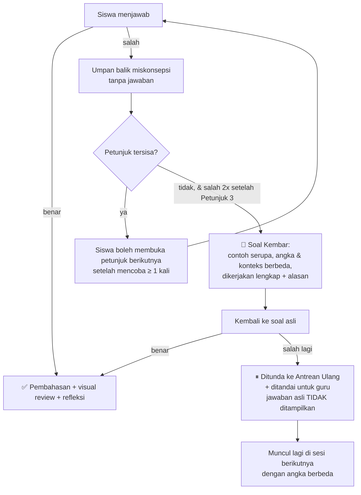

# Desain Pedagogis — Berbasis Teori Beban Kognitif

## 1. Landasan Teori

**Cognitive Load Theory (CLT)** (Sweller, 1988; Sweller, van Merriënboer & Paas, 2019) berangkat dari fakta bahwa memori kerja manusia terbatas, kira-kira 4 ± 1 elemen baru dalam satu waktu. Beban saat belajar terdiri atas:

| Jenis beban | Sumber | Strategi aplikasi |
|---|---|---|
| **Intrinsik (IL)** | Kompleksitas materi itu sendiri (jumlah elemen yang saling berinteraksi) | **Kelola**: urutkan dari sederhana ke kompleks, latih prasyarat lebih dulu |
| **Ekstrinsik (EL)** | Cara penyajian yang tidak membantu belajar | **Kurangi**: hilangkan hal yang membingungkan, visual jelas, tempo terkendali |
| **Germane (GL)** | Upaya mental untuk membangun skema | **Dorong**: contoh, refleksi, variasi, mencatat |

Prinsip umum: **kurangi EL agar kapasitas memori kerja tersedia untuk IL dan GL.**

## 2. Efek CLT yang Diterapkan

| Efek / Prinsip | Penjelasan singkat | Penerapan di Z-Math | Temuan |
|---|---|---|---|
| **Pre-training** | Kenalkan komponen dasar sebelum materi utama | Cek prasyarat & remedial operasi hitung (F-03) | IL3 |
| **Segmenting** | Materi dipecah menjadi bagian kecil yang dikendalikan siswa | Satu konsep per layar, tombol "Lanjut" (F-04) | EL3, K01 |
| **Worked example** | Contoh lengkap lebih efektif daripada langsung memecahkan soal bagi pemula | Contoh lengkap + alasan setiap langkah (F-08) | GL2 |
| **Fading / completion problem** | Bantuan dikurangi bertahap | Faded example → latihan mandiri (F-08) | GL3 |
| **Variability** | Variasi konteks dan struktur memperkuat skema | Generator soal dengan variasi struktur (F-09) | IL2 |
| **Self-explanation** | Siswa menjelaskan alasan langkah | Pertanyaan "Mengapa…?" pada contoh (F-08) | IL1, IL2 |
| **Signaling** | Tandai informasi penting | Sorotan kata kunci, warna tanda (F-07) | EL1 |
| **Split-attention / spatial contiguity** | Gabungkan teks dan gambar yang saling terkait | Label langsung di garis bilangan (F-05) | EL2 |
| **Multimedia** | Kata + gambar lebih baik daripada kata saja | Garis bilangan, ilustrasi kontekstual (F-05, F-06) | EL2, K02 |
| **Redundancy** | Hindari informasi berulang yang tidak perlu | Tidak membacakan teks yang sudah tertulis bersamaan | — |
| **Coherence (seductive details)** | Buang hiasan yang tidak relevan | Tanpa animasi atau maskot yang mengganggu saat belajar | EL |
| **Expertise reversal** | Bantuan untuk pemula bisa membebani siswa yang sudah mahir | Panduan bisa dimatikan pada level lanjut (F-06 AC4) | — |
| **Generative learning** | Membuat ringkasan atau catatan sendiri | Catatan pribadi (F-11) | GL1 |

## 3. Pendekatan Konkret → Representasional → Abstrak (CRA)

Sebagai respons terhadap EL2 dan K02, setiap konsep disajikan dalam tiga tahap:

```
KONKRET               →   REPRESENTASIONAL           →   ABSTRAK
Konteks nyata:            Garis bilangan interaktif:     Simbol:
penyelam, suhu, lift      lompatan berwarna              (−2) + (−3) = −5
```

Contoh untuk penjumlahan dua bilangan negatif:
1. **Konkret**: "Penyelam berada 2 meter di bawah permukaan laut, lalu turun lagi 3 meter."
2. **Representasional**: Visual kontekstual lebih dulu (skala laut: penyelam turun 2 m lalu 3 m), kemudian garis bilangan sebagai jembatan: mulai di 0, lompat 2 langkah ke kiri (merah), lalu 3 langkah ke kiri (merah), berhenti di −5. Katalog visual lengkap (termometer, lift, keping +/−, dll.) ada di [VISUALISASI.md](VISUALISASI.md).
3. **Abstrak**: (−2) + (−3) = −5. Aturan: "Jika tandanya sama, jumlahkan lalu beri tanda yang sama."

Aturan atau rumus **selalu muncul paling akhir** sebagai ringkasan dari pengalaman visual, bukan sebagai titik awal. Ini menjawab IL2 ("lihat rumusnya aja").

## 4. Struktur Satu Topik (Pola Pelajaran)

Setiap topik dalam modul mengikuti pola tetap. Pola yang konsisten itu sendiri menurunkan beban ekstrinsik, karena siswa tidak perlu mempelajari ulang cara memakai aplikasi.

```
1. Pemantik (1 layar)       — situasi nyata singkat + pertanyaan
2. Eksplorasi (2–3 layar)   — garis bilangan interaktif, siswa mencoba
3. Konsep (1–2 layar)       — kesimpulan/aturan dari eksplorasi
4. Worked example (1–2)     — contoh lengkap + "Mengapa?"
5. Faded example (1–2)      — sebagian langkah diisi siswa
6. Latihan mandiri (≥ 5)    — dengan petunjuk bertingkat
7. Rangkuman (1 layar)      — 3–5 poin + tombol "Simpan ke Catatanku"
```

Di akhir setiap modul ada **Misi Literasi** (F-21): stimulus nyata (teks, tabel, grafik) dengan soal berjenjang pemahaman → penerapan → penalaran. Lihat [LITERASI-MATEMATIKA.md](LITERASI-MATEMATIKA.md).

## 5. Kerangka Soal Cerita 4 Langkah

Kerangka ini dirancang untuk IL1 dan EL1 dan diadaptasi dari langkah pemecahan masalah Polya.

| Langkah | Nama di aplikasi | Aktivitas siswa | Bantuan aplikasi |
|---|---|---|---|
| 1 | **Pahami** (Diketahui) | Mengetuk informasi penting di teks soal | Kata kunci disorot, glosarium tanda +/− |
| 2 | **Ditanya** | Memilih apa yang ditanyakan dari pilihan | Kalimat pertanyaan disorot |
| 3 | **Buat Model** | Menyusun kalimat matematika (drag & drop angka/operasi) | Ilustrasi konteks ↔ garis bilangan |
| 4a | **Hitung** | Menghitung hasil model | Petunjuk 3 tingkat (tanpa jawaban) |
| 4b | **Tafsirkan & Periksa** | Menyatakan arti hasil dalam konteks dan menilai kewajarannya | Visual kontekstual mode `review` (setelah benar), pertanyaan "Apakah masuk akal?" |

Langkah 1–3 adalah proses **merumuskan**, 4a adalah **menggunakan**, dan 4b adalah **menafsirkan & mengevaluasi** dalam kerangka literasi matematika PISA (lihat [LITERASI-MATEMATIKA.md](LITERASI-MATEMATIKA.md)). Cara aplikasi memodelkan berbagai jenis soal cerita dijelaskan di [PEMODELAN-SOAL-CERITA.md](PEMODELAN-SOAL-CERITA.md).

Contoh (dari soal pemantik wawancara):
> Seorang penyelam mula-mula berada di kedalaman 2 meter di bawah permukaan laut. Ia kemudian menyelam 3 meter lebih dalam, lalu naik 1 meter. Di kedalaman berapa penyelam sekarang?

- **Pahami**: "2 meter di bawah permukaan" → −2. "3 meter lebih dalam" → −3. "naik 1 meter" → +1.
- **Ditanya**: posisi akhir penyelam.
- **Model**: (−2) + (−3) + 1.
- **Hitung**: −4.
- **Tafsirkan & Periksa**: −4 berarti 4 meter di bawah permukaan laut. Hasil masuk akal karena penyelam turun lebih banyak daripada naiknya, sehingga ia masih berada di bawah laut.

## 6. Kebijakan Petunjuk 3 Tingkat: "Bimbing, Jangan Beri Jawaban"

### 6.1 Prinsip
Siswa **tidak pernah diberi jawaban langsung**. Aplikasi membimbing dengan petunjuk yang makin konkret, tetapi langkah terakhir selalu dilakukan oleh siswa sendiri. Dasarnya:
- **Generation effect & productive struggle**: informasi yang ditemukan sendiri diingat lebih baik daripada informasi yang diterima.
- **Scaffolding & fading**: bantuan diberikan secukupnya, lalu dikurangi.
- **Mengatasi IL2**: siswa yang terbiasa "lihat rumusnya aja" dipaksa memahami *mengapa*, karena jawaban tidak dapat disalin.
- **Beban kognitif tetap terkendali**: petunjuk mencegah siswa buntu terlalu lama, yang justru menambah beban ekstrinsik.

### 6.2 Tiga Tingkat Petunjuk (berlaku untuk setiap langkah soal)

| Tingkat | Nama | Fungsi kognitif | Isi | Contoh (soal penyelam, langkah ③ Buat Model) |
|---|---|---|---|---|
| **Petunjuk 1** | **Makna** | Mengaktifkan konsep dan memahami bahasa soal | Pertanyaan pemandu atau penjelasan kata kunci. **Tidak** menyebut angka hasil | "Kata *di bawah permukaan laut* dan *lebih dalam* menunjukkan bilangan positif atau negatif?" |
| **Petunjuk 2** | **Visual** | Representasi konkret (EL2) | Visual kontekstual mode `hint`: keadaan awal dan **arah** perubahan saja, tanpa posisi akhir | Skala laut: penyelam di −2, panah merah ke bawah bertanda "lebih dalam 3", posisi akhir "?" |
| **Petunjuk 3** | **Strategi** | Merencanakan penyelesaian | Kerangka model dengan kotak kosong, atau langkah pertama **tanpa** hasil | "Posisi awal + perubahan 1 + perubahan 2 = posisi akhir → (−2) + (□) + (□) = ?" |

**Larangan isi petunjuk:**
- ❌ Menyebut atau menampilkan hasil akhir (sebagai angka, label visual, atau posisi akhir).
- ❌ Memberikan model lengkap pada langkah ③ (Petunjuk 3 selalu menyisakan ≥ 1 kotak kosong).
- ❌ Pilihan ganda yang tinggal satu opsi (eliminasi berlebihan).

### 6.3 Alur Lengkap Saat Siswa Kesulitan



- **Soal Kembar** (*isomorphic worked example*) memberi contoh lengkap tanpa membocorkan jawaban soal asli, karena angka dan konteksnya berbeda. Siswa harus **mentransfer** strateginya sendiri (GL3).
- **Antrean Ulang** memanfaatkan *spacing effect*: soal sejenis muncul lagi setelah jeda.
- Guru melihat daftar soal yang ditunda di dasbor (F-13), sebagai bahan bimbingan langsung.

### 6.4 Pengaruh terhadap Penilaian (mastery)
| Kondisi saat benar | Bobot |
|---|---|
| Tanpa petunjuk | 1,0 |
| Dengan Petunjuk 1 | 0,8 |
| Dengan Petunjuk 2 | 0,6 |
| Dengan Petunjuk 3 | 0,4 |
| Setelah Soal Kembar | 0,2 |
| Ditunda (`deferred`) | 0 |

Siswa melihat pesan apresiasi di setiap kondisi benar ("Kamu berhasil menemukannya sendiri!"), bukan angka bobot.

### 6.5 Umpan Balik Langsung

**Deteksi miskonsepsi umum** untuk umpan balik spesifik. Umpan balik menunjukkan **di mana** pikiran siswa keliru, tetapi tidak menyebut jawaban benar:

| Miskonsepsi | Contoh jawaban salah | Umpan balik |
|---|---|---|
| Tanda hasil salah | (−5) + 3 = 2 | "Hampir! Coba lihat garis bilangan: dari −5 lompat 3 ke kanan, berhenti di mana?" |
| Menjumlahkan nilai mutlak | (−5) + 3 = 8 atau −8 | "Tanda kedua bilangan berbeda, jadi arahnya berlawanan." |
| Salah konsep pengurangan negatif | 4 − (−2) = 2 | "Mengurangi bilangan negatif sama dengan menambah lawannya." |
| Aturan tanda perkalian | (−3) × (−4) = −12 | "Negatif kali negatif hasilnya positif." |
| Salah membandingkan | −7 > −2 | "Di garis bilangan, bilangan di sebelah kanan selalu lebih besar." |

## 7. Mendukung Strategi Belajar Siswa (GL)

- **Catatan pribadi** (GL1): selalu dapat diakses dari setiap layar pelajaran. Contoh dan rangkuman dapat disalin ke catatan.
- **Belajar dari contoh** (GL2): perpustakaan "Contoh Soal" dapat dicari per topik.
- **Transfer mandiri** (GL3): setelah pola dikuasai, soal berikutnya divariasikan strukturnya (mis. letak bilangan yang tidak diketahui dipindah: 3 + □ = −2).
- **Diskusi teman** (GL1, fitur C): berbagi catatan atau soal ke teman sekelas.

## 8. Pemetaan Kurikulum

| Kurikulum | Rumusan | Modul Z-Math |
|---|---|---|
| K-13 KD 3.1 | Menjelaskan dan menentukan urutan pada bilangan bulat (positif dan negatif) dan pecahan | M1, M2 |
| K-13 KD 3.2 | Menjelaskan dan melakukan operasi hitung bilangan bulat dan pecahan dengan memanfaatkan berbagai sifat operasi | M3, M4, M5 |
| K-13 KD 4.1 / 4.2 | Menyelesaikan masalah yang berkaitan dengan urutan dan operasi hitung bilangan bulat | M6 |
| Kurikulum Merdeka Fase D (Bilangan) | Membaca, menulis, dan membandingkan bilangan bulat; melakukan operasi aritmetika bilangan bulat dan menyelesaikan masalah kontekstual | M1–M6 |

## 9. Referensi

- Sweller, J. (1988). Cognitive load during problem solving: Effects on learning. *Cognitive Science, 12*(2), 257–285.
- Sweller, J., van Merriënboer, J. J. G., & Paas, F. (2019). Cognitive architecture and instructional design: 20 years later. *Educational Psychology Review, 31*, 261–292.
- Mayer, R. E. (2021). *Multimedia Learning* (3rd ed.). Cambridge University Press.
- Leppink, J., Paas, F., Van der Vleuten, C. P. M., Van Gog, T., & Van Merriënboer, J. J. G. (2013). Development of an instrument for measuring different types of cognitive load. *Behavior Research Methods, 45*, 1058–1072.
- Renkl, A. (2014). Toward an instructionally oriented theory of example-based learning. *Cognitive Science, 38*(1), 1–37.
- Polya, G. (1945). *How to Solve It*. Princeton University Press.
- Wood, D., Bruner, J. S., & Ross, G. (1976). The role of tutoring in problem solving. *Journal of Child Psychology and Psychiatry, 17*(2), 89–100.
- Slamecka, N. J., & Graf, P. (1978). The generation effect: Delineation of a phenomenon. *Journal of Experimental Psychology: Human Learning and Memory, 4*(6), 592–604.
- Kapur, M. (2014). Productive failure in learning math. *Cognitive Science, 38*(5), 1008–1022.
- OECD. (2023). *PISA 2022 Assessment and Analytical Framework*. OECD Publishing.
- Kemendikbud. (2017). *Matematika SMP/MTs Kelas VII Semester 1* (Buku Siswa, Kurikulum 2013 Edisi Revisi).
