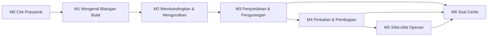

# Kurikulum dan Konten — Modul Bilangan Bulat

## 1. Peta Modul



Modul dibuka berurutan. M6 dapat diakses setelah M3, dengan soal perkalian dan pembagian baru tersedia setelah M4 selesai.

## 2. Rincian Modul

### M0 — Cek Prasyarat (F-03)
- **Tujuan**: Memastikan siswa lancar dengan operasi hitung bilangan cacah.
- **Isi**: 8 soal (2 untuk tiap operasi +, −, ×, ÷).
- **Remedial**: Pelajaran mini (3–4 layar) per operasi yang belum dikuasai.
- **Estimasi**: 5–10 menit.

### M1 — Mengenal Bilangan Bulat
| Topik | Tujuan pembelajaran | Konteks |
|---|---|---|
| 1.1 Bilangan positif, negatif, dan nol | Menjelaskan arti bilangan negatif dalam kehidupan sehari-hari | Suhu, lantai gedung/basement, permukaan laut |
| 1.2 Garis bilangan | Menempatkan bilangan bulat pada garis bilangan | Termometer, lift |
| 1.3 Lawan bilangan | Menentukan lawan sebuah bilangan | Maju–mundur |

### M2 — Membandingkan dan Mengurutkan
| Topik | Tujuan | Konteks |
|---|---|---|
| 2.1 Membandingkan (<, >, =) | Membandingkan dua bilangan bulat dengan garis bilangan | Suhu kota-kota |
| 2.2 Mengurutkan | Mengurutkan bilangan bulat naik/turun | Ketinggian tempat |

### M3 — Penjumlahan dan Pengurangan
| Topik | Tujuan | Konteks |
|---|---|---|
| 3.1 Penjumlahan pada garis bilangan | Memodelkan a + b sebagai lompatan | Langkah maju/mundur |
| 3.2 Penjumlahan bertanda sama dan berbeda | Menyimpulkan aturan dari eksplorasi | Untung–rugi |
| 3.3 Pengurangan sebagai penjumlahan lawan | a − b = a + (−b) | Perubahan suhu |
| 3.4 Operasi campuran + dan − | Menyelesaikan 3 bilangan atau lebih | Lift naik-turun |

### M4 — Perkalian dan Pembagian
| Topik | Tujuan | Konteks |
|---|---|---|
| 4.1 Perkalian sebagai penjumlahan berulang | 3 × (−2) = (−2)+(−2)+(−2) | Penurunan suhu per jam |
| 4.2 Aturan tanda perkalian | Menyimpulkan pola tanda | Tabel pola |
| 4.3 Pembagian bilangan bulat | Pembagian sebagai kebalikan perkalian | Membagi utang |

**Status implementasi:** `m4-t1` Perkalian (penjumlahan berulang, pola tanda) dan `m4-t2` Pembagian (kebalikan perkalian, bagi rata). Template latihan: `num-mul`, `temp-rpt`, `num-div`, `money-prt`, `temp-prt`.

### M5 — Sifat-sifat Operasi
| Topik | Tujuan |
|---|---|
| 5.1 Komutatif & asosiatif | Memakai sifat untuk mempermudah hitungan |
| 5.2 Distributif | a × (b + c) = a×b + a×c |
| 5.3 Urutan operasi | Kurung → ×/÷ → +/− |

### M6 — Soal Cerita & Pemodelan (F-06, F-20)
| Topik | Konteks | Jenis soal | Visual |
|---|---|---|---|
| 6.1 Kedalaman & ketinggian | Penyelam, pendaki, permukaan laut | CHG, CMP | Skala laut, profil ketinggian |
| 6.2 Suhu | Kenaikan/penurunan suhu, selisih suhu antarkota, rata-rata | CHG, CMP, RPT, AVG | Termometer |
| 6.3 Keuangan sederhana | Untung, rugi, utang, tabungan, bagi rata | CMB, PRT, CHG | Dompet/saldo |
| 6.4 Skor & poin | Sistem poin kuis (benar +4, salah −1) | SCR | Papan skor |
| 6.5 Gedung & lift | Naik-turun lantai, basement | CHG, MLT | Gedung & lift |
| 6.6 Campuran | Soal multi-langkah | MLT | Sesuai konteks |

Setiap topik merotasi posisi yang tidak diketahui (awal/perubahan/akhir). Spesifikasi jenis soal ada di [PEMODELAN-SOAL-CERITA.md](PEMODELAN-SOAL-CERITA.md).

### Misi Literasi per Modul (F-21)
| Modul | Misi | Stimulus | Tipe penalaran |
|---|---|---|---|
| M1 | "Gedung Parkir Mal" | Denah lantai + basement | Masuk Akal? |
| M2 | "Suhu Kota Dunia" | Tabel suhu (data ilustratif) | Siapa yang Benar? |
| M3 | "Petualangan Penyelam" | Teks + gambar skala laut | Temukan Kesalahan |
| M4 | "Suhu Freezer" | Grafik penurunan suhu per jam | Masuk Akal? |
| M5 | "Hitung Cepat Kasir" | Struk belanja dengan diskon & retur | Siapa yang Benar? |
| M6 | "Olimpiade Matematika" | Aturan skor + tabel hasil peserta | Buat Ceritamu |

Kerangka literasi ada di [LITERASI-MATEMATIKA.md](LITERASI-MATEMATIKA.md).

## 3. Tingkat Kesulitan

| Level | Ciri | Panduan 4 langkah |
|---|---|---|
| 1 — Dasar | 1 operasi, bilangan −10..10 | Aktif penuh |
| 2 — Menengah | 2 operasi, bilangan −50..50 | Aktif, bisa dilewati |
| 3 — Mahir | ≥ 2 operasi, bilangan −100..100, struktur bervariasi | Nonaktif (bisa dibuka lewat petunjuk) |

Kenaikan level bersifat adaptif: 3 jawaban benar berturut-turut tanpa petunjuk membuat soal naik satu level, sedangkan 2 jawaban salah berturut-turut membuat soal turun satu level.

## 4. Glosarium Kata Kunci (F-07)

| Kata/frasa | Makna tanda | Penjelasan untuk siswa |
|---|---|---|
| di atas permukaan laut, naik, maju | + | Bergerak ke arah atas atau kanan |
| di bawah permukaan laut, turun, mundur, menyelam | − | Bergerak ke arah bawah atau kiri |
| di atas nol (suhu) | + | Lebih panas dari 0 °C |
| di bawah nol (suhu) | − | Lebih dingin dari 0 °C |
| untung, menabung, mendapat | + | Uang bertambah |
| rugi, utang, membayar, kehilangan | − | Uang berkurang |
| lantai dasar | 0 | Titik awal |
| basement / lantai bawah tanah | − | Di bawah lantai dasar |
| benar (pada kuis) | + | Menambah skor |
| salah (pada kuis) | − | Mengurangi skor |
| tidak dijawab | 0 | Skor tidak berubah |

**Kosakata soal (literasi, bukan penentu tanda)**

| Kata | Arti dalam matematika |
|---|---|
| selisih | Hasil pengurangan, yaitu jarak antara dua nilai |
| total / jumlah seluruhnya | Hasil penjumlahan semua bagian |
| rata-rata | Jumlah semua data dibagi banyaknya data |
| setiap / per | Perubahan yang berulang sama besar (perkalian) |
| dibagi rata / masing-masing | Pembagian sama besar |
| mula-mula / awalnya | Keadaan awal |
| sekarang / akhirnya | Keadaan akhir |
| lebih tinggi/rendah dari | Perbandingan dua nilai |

## 5. Format Konten (JSON)

Konten disimpan sebagai data di Supabase (tabel `lessons`, `problems`, `glossary_terms`) dan di-seed dari file `supabase/seed/*.json`.

### 5.1 Lesson
```json
{
  "id": "m3-t1",
  "module_id": "m3",
  "title": "Penjumlahan pada Garis Bilangan",
  "order": 1,
  "estimated_minutes": 10,
  "segments": [
    {
      "type": "hook",
      "text": "Suhu pagi ini −2 °C. Siang hari naik 5 °C. Berapa suhunya sekarang?",
      "media": { "kind": "illustration", "ref": "thermometer" }
    },
    {
      "type": "explore",
      "text": "Mulai dari −2. Ketuk panah kanan 5 kali.",
      "widget": { "kind": "number_line", "range": [-10, 10], "start": -2, "ops": [{ "op": "+", "value": 5 }], "interactive": true }
    },
    {
      "type": "concept",
      "text": "Menambah bilangan positif berarti bergerak ke kanan.",
      "highlight": ["ke kanan"]
    },
    {
      "type": "worked_example",
      "problem": "(−4) + 6 = ?",
      "steps": [
        { "text": "Mulai di −4.", "why": "Bilangan pertama adalah titik awal." },
        { "text": "Lompat 6 ke kanan.", "why": "6 positif, jadi arahnya ke kanan." },
        { "text": "Berhenti di 2.", "why": "Hitung lompatan: −3, −2, −1, 0, 1, 2." }
      ],
      "self_explain": "Mengapa hasilnya positif?"
    },
    {
      "type": "faded_example",
      "problem": "(−3) + 7 = ?",
      "steps": [
        { "text": "Mulai di −3.", "blank": false },
        { "text": "Lompat __ ke __.", "blank": true, "answer": ["7", "kanan"] },
        { "text": "Berhenti di __.", "blank": true, "answer": ["4"] }
      ]
    },
    { "type": "practice", "problem_template_id": "add-int-basic", "count": 5 },
    {
      "type": "summary",
      "points": [
        "Tambah positif → ke kanan.",
        "Tambah negatif → ke kiri.",
        "Hasil = posisi berhenti."
      ]
    }
  ]
}
```

### 5.2 Problem Template (untuk generator F-09)

> Format terbaru untuk soal cerita adalah **skema semantik** pada [PEMODELAN-SOAL-CERITA.md](PEMODELAN-SOAL-CERITA.md) §3, yang menambahkan `schema_type`, `unknown`, `quantities`, `relation`, `interpretation`, `sanity`, dan tag `literacy`. Contoh di bawah adalah bentuk ringkas untuk soal level 1. Field `visual` memakai nama komponen di [VISUALISASI.md](VISUALISASI.md) (mis. `sea_depth`, `thermometer`).

```json
{
  "id": "story-diver-01",
  "module_id": "m6",
  "level": 1,
  "kind": "story",
  "template": "Seorang penyelam berada {a} meter di bawah permukaan laut. Ia menyelam {b} meter lebih dalam. Di kedalaman berapa ia sekarang?",
  "params": {
    "a": { "min": 1, "max": 10 },
    "b": { "min": 1, "max": 10 }
  },
  "model": "(-{a}) + (-{b})",
  "answer_expr": "-a - b",
  "answer_unit": "meter di bawah permukaan laut",
  "keywords": ["di bawah permukaan laut", "lebih dalam"],
  "steps": {
    "known": ["-{a}", "-{b}"],
    "asked": "posisi akhir penyelam",
    "model": "(-{a}) + (-{b})",
    "result": "{answer}"
  },
  "misconceptions": ["sign_error", "abs_sum"],
  "visual": "sea_depth",
  "hints": {
    "known":  ["Kata 'di bawah permukaan laut' berarti positif atau negatif?", "@visual:hint", "Ada 2 bilangan, keduanya negatif."],
    "model":  ["Posisi awal + perubahan = posisi akhir.", "@visual:hint", "(−{a}) + (□) = ?"],
    "result": ["Tanda kedua bilangan sama atau berbeda?", "@visual:hint", "Jumlahkan nilainya, lalu tentukan tandanya."]
  },
  "literacy": { "indicators": ["LM1", "LM4", "LM6"], "process": "formulate", "cognitive_level": "application", "akm_context": "scientific" }
}
```

Field `hints` bersifat opsional. Jika kosong, `hint_generator` membuat petunjuk otomatis dari skema. `@visual:hint` berarti tampilkan visual mode `hint`. Petunjuk tulisan tangan tetap divalidasi oleh test "tanpa bocor" (tidak boleh memuat `{answer}`).

### 5.4 Literacy Mission
```json
{
  "id": "lm-m2-01",
  "module_id": "m2",
  "title": "Suhu Kota Dunia di Bulan Januari",
  "stimulus": {
    "kind": "table",
    "caption": "Data ilustratif",
    "columns": ["Kota", "Terendah (°C)", "Tertinggi (°C)"],
    "rows": [["Moskow", -10, -4], ["Tokyo", 1, 10], ["Jakarta", 24, 31], ["Toronto", -9, -1]]
  },
  "items": [
    { "template_id": "lm-m2-01-q1", "format": "multiple_choice", "cognitive_level": "understanding", "indicators": ["LM3"] },
    { "template_id": "lm-m2-01-q2", "format": "short_answer", "cognitive_level": "application", "indicators": ["LM4", "LM5"] },
    { "template_id": "lm-m2-01-q3", "format": "matching", "cognitive_level": "application", "indicators": ["LM5"] },
    { "template_id": "lm-m2-01-q4", "format": "complex_multiple_choice", "cognitive_level": "reasoning", "indicators": ["LM7"] },
    { "template_id": "lm-m2-01-q5", "format": "reason_choice", "cognitive_level": "reasoning", "indicators": ["LM8", "LM9"] }
  ]
}
```

### 5.3 Glossary Term
```json
{ "phrase": "di bawah permukaan laut", "sign": "-", "explanation": "Posisi lebih rendah dari laut, ditulis dengan bilangan negatif." }
```

## 6. Pedoman Penulisan Konten

1. Kalimat ≤ 15 kata. Satu ide per kalimat.
2. Gunakan konteks yang akrab bagi siswa Indonesia (suhu di daerah pegunungan, penyelam, uang jajan, lift mal).
3. Tulis bilangan negatif dalam kurung saat dioperasikan: (−3), bukan −3 saja.
4. Gunakan tanda minus asli "−" (U+2212) untuk tampilan, dan "-" untuk data.
5. Setiap worked example wajib punya kolom `why` pada tiap langkah.
6. Setiap soal cerita wajib punya `keywords` dan `steps`.
7. Hindari nama tokoh yang mengandung stereotip. Gunakan nama yang beragam.
8. Konten ditinjau oleh minimal 1 guru matematika sebelum rilis.
9. Setiap soal wajib punya 3 tingkat petunjuk per langkah (manual atau otomatis), dan **tidak satu pun** boleh memuat jawaban akhir.
10. Setiap soal wajib diberi tag `literacy` (indikator LM, proses, level kognitif, konteks AKM).
11. Data nyata (suhu, ketinggian) dicantumkan sumbernya. Data karangan diberi label "data ilustratif".

## 7. Target Jumlah Konten MVP

| Modul | Pelajaran | Worked example | Templat soal | Misi Literasi (soal) |
|---|---|---|---|---|
| M0 | 4 remedial | 4 | 4 | — |
| M1 | 3 | 3 | 6 | 1 (4) |
| M2 | 2 | 2 | 4 | 1 (5) |
| M3 | 4 | 6 | 10 | 1 (5) |
| M4 | 3 | 4 | 8 | 1 (4) |
| M5 | 3 | 3 | 6 | 1 (4) |
| M6 | 6 | 10 | 24 (8 jenis × 3 posisi tak diketahui) | 1 (5) |
| **Total** | **25** | **32** | **62** | **6 (27)** |

Setiap templat soal cerita juga membutuhkan **1 templat Soal Kembar** dengan konteks berbeda tetapi jenis skema sama. Templat dari konteks lain dengan `schema_type` yang sama dapat dipakai.

## 8. Ujian Akhir (F-23)

Susunan di `backend/app/content/exam.json`. Setiap *slot* menghasilkan satu soal; templatnya dipilih dari alternatif slot berdasarkan `seed`.

| Tahap | Level | Slot (template ujian) |
|---|---|---|
| 1 Dasar | 1 | representasi (`ex-rep-lab`/`ex-rep-office`/`ex-rep-sub`), tambah/kurang (`ex-num-add`/`ex-num-sub`, −50..50), `ex-num-mul`, `ex-num-div` |
| 2 Menengah | 2 | `ex-temp-cmp`, `ex-lift-chg-start`, `ex-temp-altitude` (RPT), `ex-money-debt` (PRT) |
| 3 HOTS | 3 | `ex-num-mix` (urutan operasi), `ex-temp-rpt-start`/`ex-sea-mlt-change`, `ex-money-mixed` (gabung lalu bagi), `ex-score` (skor cerdas cermat, ada informasi pengecoh) |

Aturan bank soal: template ujian memakai `"pool": "exam"`, tidak boleh ada di `practice.templates` pelajaran (dicek loader), dan soal numerik ujian memakai rentang angka yang **tidak mungkin** dihasilkan generator latihan (dicek `tests/test_exam.py`).

## 9. Format Penyajian Teks Pelajaran

Semua segmen pelajaran memakai format yang sama (dicek oleh `backend/tests/test_lesson_copy.py`):

| Field | Kegunaan | Tampilan |
|---|---|---|
| `text` | Penjelasan singkat. Pisahkan paragraf dengan baris kosong (`\n\n`) | Paragraf pendek, jarak baris lega |
| `lines` | Rumus/pola baris per baris, sejajar pada `=`, `→`, `<`, atau `>`. Baris yang diawali `= ` melanjutkan baris di atasnya | Kotak monospace; hasil berupa bilangan tunggal diberi warna tanda (biru/merah/abu) |
| `callout` | Kesimpulan atau kaitan gerakan ↔ notasi (pada segmen *explore*) | Kotak sorotan kuning dengan ikon 💡 |

Aturan: ≤ 60 kata per layar, ≤ 15 kata per kalimat, gaya bahasa hangat ("Yuk, coba…", "Coba pikirkan…"). Segmen konsep yang memuat ≥ 3 baris pola wajib punya `callout`.
