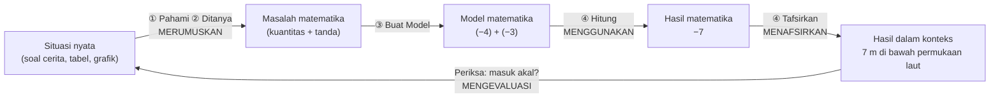

# Literasi Matematika — Kerangka dan Penerapan di Z-Math

## 1. Mengapa Literasi Matematika?

Tujuan Z-Math tidak berhenti pada kemampuan menghitung bilangan bulat. Siswa juga diharapkan mampu **menggunakan bilangan bulat untuk memahami dan menyelesaikan masalah nyata**: membaca situasi, mengubahnya menjadi model matematika, menyelesaikannya, lalu menafsirkan hasilnya kembali ke situasi semula.

Kebutuhan ini sejalan dengan temuan wawancara. Siswa "kurang paham bagaimana mengerjakan soal cerita" (IL1), "bingung apa yang ditanyakan" (EL1), dan "lihat rumusnya aja" (IL2). Ketiga temuan ini menunjukkan bahwa yang kurang adalah **literasi**, bukan kemampuan berhitung.

## 2. Kerangka Acuan

### 2.1 PISA 2022 (OECD)

Literasi matematika adalah kapasitas individu untuk **bernalar secara matematis** serta **merumuskan, menggunakan, dan menafsirkan** matematika untuk menyelesaikan masalah dalam berbagai konteks dunia nyata.

| Proses PISA | Arti | Bentuk di Z-Math |
|---|---|---|
| **Merumuskan** (*Formulate*) | Mengubah situasi nyata menjadi masalah matematika | Langkah ① Pahami, ② Ditanya, ③ Buat Model |
| **Menggunakan** (*Employ*) | Menerapkan konsep, fakta, dan prosedur | Langkah ④ Hitung |
| **Menafsirkan & Mengevaluasi** (*Interpret & Evaluate*) | Mengartikan hasil dalam konteks dan menilai kewajarannya | Langkah ④ Periksa: "Apa arti −7 dalam cerita ini? Apakah masuk akal?" |
| **Penalaran matematis** (inti) | Memberi alasan, menyimpulkan, membuktikan | Pertanyaan "Mengapa?", pilihan alasan, "Temukan kesalahan" |

Kategori konten yang relevan adalah **Kuantitas** (*Quantity*). Konteks PISA terdiri atas pribadi, pekerjaan, sosial, dan ilmiah.

### 2.2 AKM Numerasi (Asesmen Nasional, Kemendikbudristek)

| Dimensi | Kategori | Penerapan |
|---|---|---|
| Konten | **Bilangan** (fokus MVP) | Representasi, sifat urutan, operasi bilangan bulat |
| Level kognitif | **Pemahaman** → **Penerapan** → **Penalaran** | Setiap Misi Literasi berisi ketiga level secara berurutan |
| Konteks | **Personal**, **Sosial Budaya**, **Saintifik** | Uang jajan dan skor (personal), lift mal dan utang koperasi (sosial budaya), suhu dan kedalaman laut (saintifik) |
| Bentuk soal | Pilihan ganda, pilihan ganda kompleks, menjodohkan, isian singkat, uraian | Semua bentuk didukung. Uraian memakai pilihan alasan dan teks bebas opsional |
| Level kompetensi | Perlu Intervensi Khusus, Dasar, Cakap, Mahir | Dipakai untuk melaporkan perkembangan literasi siswa ke guru |

## 3. Siklus Pemodelan Matematika di Z-Math

Setiap soal cerita di Z-Math melewati **seluruh siklus** ini. Siswa tidak boleh berhenti di angka −7. Ia harus menuliskan atau memilih makna −7 dalam cerita tersebut. Detail mesin pemodelan ada di [PEMODELAN-SOAL-CERITA.md](PEMODELAN-SOAL-CERITA.md).

## 4. Indikator Literasi Matematika (Bilangan Bulat)

| Kode | Indikator | Proses PISA | Level AKM | Contoh tugas |
|---|---|---|---|---|
| LM1 | Mengidentifikasi kuantitas dan tandanya dari teks | Merumuskan | Pemahaman | Ketuk semua bilangan pada soal, lalu tentukan tandanya |
| LM2 | Menentukan apa yang ditanyakan | Merumuskan | Pemahaman | Pilih kalimat tanya yang tepat |
| LM3 | Membaca data dari tabel, grafik, atau infografis | Merumuskan | Pemahaman | "Kota mana yang paling dingin?" |
| LM4 | Menyusun model matematika dari situasi | Merumuskan | Penerapan | Susun kalimat matematika dengan drag & drop |
| LM5 | Menyelesaikan model dengan prosedur yang tepat | Menggunakan | Penerapan | Hitung langkah demi langkah |
| LM6 | Menafsirkan hasil ke dalam konteks | Menafsirkan | Penerapan | "−7 berarti …" |
| LM7 | Mengevaluasi kewajaran hasil | Mengevaluasi | Penalaran | "Apakah suhu −150 °C masuk akal untuk kota ini?" |
| LM8 | Memberikan alasan atau argumen | Penalaran | Penalaran | "Mengapa Dina benar?" lalu pilih alasan |
| LM9 | Menemukan dan memperbaiki kesalahan | Penalaran | Penalaran | Analisis jawaban teman fiktif |
| LM10 | Membuat soal cerita sendiri dari model | Merumuskan (balik) | Penalaran | "Buat cerita untuk (−5) + 8" |

Setiap soal di bank soal **ditandai** dengan indikator LM, proses PISA, level kognitif, dan konteks AKM (lihat [SKEMA-DATABASE.md](SKEMA-DATABASE.md), kolom `literacy`).

## 5. Fitur Literasi di Aplikasi

### 5.1 Langkah "Tafsirkan" pada Pemandu Soal Cerita (F-06)
Langkah ④ dipecah menjadi dua sub-langkah:
- **④a Hitung**: hasil numerik.
- **④b Tafsirkan & Periksa**: memilih atau menulis makna hasil ("7 meter di bawah permukaan laut") dan menjawab "Apakah masuk akal?".

### 5.2 Misi Literasi (F-21)
Satu misi terdiri atas **1 stimulus + 3–5 soal** yang tingkatnya naik bertahap, seperti format AKM.

| Komponen | Isi |
|---|---|
| Stimulus | Teks cerita pendek, tabel, grafik garis, infografis, atau gambar (termometer, peta ketinggian) |
| Soal 1 — Pemahaman | Membaca informasi langsung dari stimulus |
| Soal 2–3 — Penerapan | Membuat model dan menghitung |
| Soal 4–5 — Penalaran | Mengevaluasi, memberi alasan, atau menemukan kesalahan |

**Contoh Misi: "Suhu Kota Dunia di Bulan Januari"** *(data ilustratif)*

| Kota | Suhu terendah (°C) | Suhu tertinggi (°C) |
|---|---|---|
| Moskow | −10 | −4 |
| Tokyo | 1 | 10 |
| Jakarta | 24 | 31 |
| Toronto | −9 | −1 |

1. *(Pemahaman, pilihan ganda)* Kota mana yang memiliki suhu terendah paling dingin?
2. *(Penerapan, isian)* Berapa selisih suhu tertinggi dan terendah di Moskow? *(Model: −4 − (−10))*
3. *(Penerapan, menjodohkan)* Jodohkan setiap kota dengan selisih suhunya.
4. *(Penalaran, pilihan ganda kompleks)* Pilih semua pernyataan yang benar: "Suhu tertinggi Toronto lebih rendah dari suhu terendah Tokyo", dan seterusnya.
5. *(Penalaran, uraian dengan pilihan alasan)* Raka berkata: "Selisih suhu Toronto adalah 10 °C karena 9 + 1 = 10." Apakah Raka benar? Pilih alasanmu.

### 5.3 Tipe Tugas Penalaran
| Tipe | Deskripsi | Indikator |
|---|---|---|
| **Masuk Akal?** | Disajikan hasil, siswa menilai kewajarannya terhadap konteks | LM7 |
| **Temukan Kesalahan** | Jawaban tokoh fiktif yang mengandung miskonsepsi. Siswa menunjuk langkah yang salah dan memilih perbaikannya | LM9 |
| **Siapa yang Benar?** | Dua tokoh dengan jawaban berbeda. Siswa memilih yang benar dan alasannya | LM8 |
| **Buat Ceritamu** | Diberi model (mis. (−5) + 8), siswa memilih konteks lalu menyusun cerita dari potongan kalimat (atau menulis bebas) | LM10 |
| **Satu Model, Banyak Cerita** | Mencocokkan satu model dengan beberapa cerita berbeda konteks | LM4, LM6 |

### 5.4 Kosakata Matematika (mendukung EL1)
Glosarium kata kunci ([KURIKULUM-KONTEN.md](KURIKULUM-KONTEN.md) §4) diperluas dengan **kosakata soal**: *selisih, total, rata-rata, berturut-turut, masing-masing, mula-mula, sekarang, lebih tinggi/rendah dari*. Setiap kata dapat diketuk untuk melihat artinya dan contoh operasinya.

## 6. Prinsip Desain Literasi (tetap rendah beban kognitif)

1. **Stimulus pendek.** Teks ≤ 80 kata, tabel ≤ 5 baris × 3 kolom.
2. **Stimulus tetap terlihat** saat siswa menjawab: panel bisa dilipat, tetapi tidak hilang (*split-attention* rendah).
3. **Naik bertahap**: pemahaman → penerapan → penalaran dalam satu misi.
4. **Konteks akrab** bagi siswa Indonesia, dengan data ilustratif yang diberi label jelas.
5. **Penalaran dinilai dari alasan**, bukan hanya jawaban akhir.
6. Misi literasi dibuka **setelah** konsep dasar modul terkait dikuasai (mastery ≥ 0,7), sesuai prinsip *expertise reversal*.

## 7. Pengukuran Perkembangan Literasi

| Data | Sumber | Ditampilkan ke |
|---|---|---|
| Skor per indikator LM1–LM10 | Tag literasi pada setiap jawaban | Siswa (profil "Kekuatanku"), guru |
| Skor per proses PISA (merumuskan/menggunakan/menafsirkan) | Agregat indikator | Guru |
| Level kompetensi (Perlu Intervensi Khusus/Dasar/Cakap/Mahir) | Skor Misi Literasi tiap modul | Guru |
| Pre/post-test literasi | Instrumen gaya AKM | Peneliti (lihat [TESTING-EVALUASI.md](TESTING-EVALUASI.md)) |

**Aturan level kompetensi (per modul, dari Misi Literasi):**
| Level | Kriteria |
|---|---|
| Mahir | ≥ 80% benar, termasuk ≥ 1 soal penalaran tanpa petunjuk |
| Cakap | 60–79% benar |
| Dasar | 40–59% benar |
| Perlu Intervensi Khusus | < 40% benar |

## 8. Referensi
- OECD. (2023). *PISA 2022 Assessment and Analytical Framework*. OECD Publishing.
- Pusat Asesmen Pendidikan, Kemendikbudristek. (2020). *AKM dan Implikasinya pada Pembelajaran*.
- Blum, W., & Leiß, D. (2007). How do students and teachers deal with modelling problems? Dalam *Mathematical Modelling (ICTMA 12)*, 222–231.
- Silver, E. A. (1994). On mathematical problem posing. *For the Learning of Mathematics, 14*(1), 19–28.
