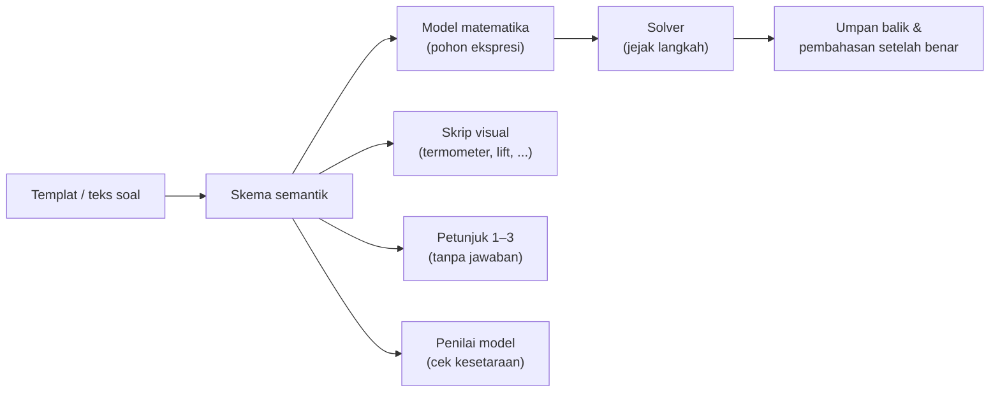
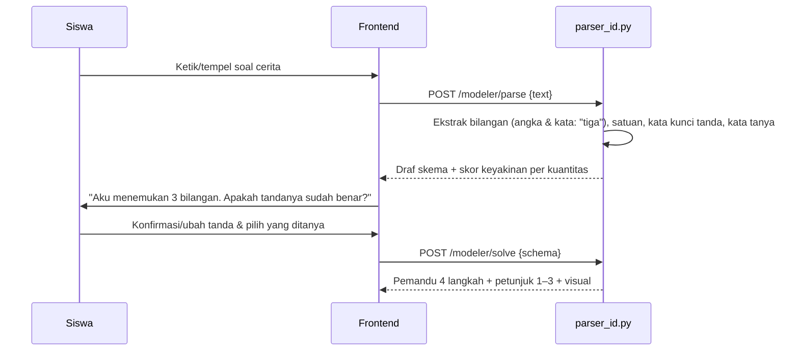

# Mesin Pemodelan Soal Cerita

Dokumen ini menjelaskan cara Z-Math **memodelkan berbagai jenis soal cerita** ke dalam model matematika, **menyelesaikannya langkah demi langkah**, serta menghasilkan **visual** dan **petunjuk 3 tingkat** secara otomatis.

Fitur terkait: F-06 (Pemandu Soal Cerita), F-09 (Generator Soal), F-10 (Petunjuk 3 Tingkat), F-19 (Visual Kontekstual), F-20 (Mesin Pemodelan), F-22 (Pemodel Bebas).

---

## 1. Ide Utama

Setiap soal cerita direpresentasikan sebagai **skema semantik**: apa saja kuantitasnya, apa tandanya, bagaimana hubungannya, dan apa yang tidak diketahui. Skema ini adalah satu-satunya sumber kebenaran. Semua bagian lain **diturunkan** darinya:



Dengan pendekatan ini, menambah konteks baru (mis. "skor kuis") cukup dilakukan dengan menambah data, tanpa mengubah kode.

## 2. Taksonomi Jenis Soal Cerita Bilangan Bulat

| Kode | Jenis | Struktur | Contoh konteks | Model umum |
|---|---|---|---|---|
| **CHG** | Perubahan (*change*) | awal ± perubahan = akhir | Suhu naik/turun, penyelam, lift, saldo | a + b = c |
| **CMP** | Perbandingan / selisih | selisih dua keadaan | Selisih suhu dua kota, beda ketinggian puncak dan dasar laut | a − b |
| **CMB** | Gabungan (*combine*) | jumlah beberapa bagian | Untung–rugi 5 hari, total poin | a + b + c + … |
| **RPT** | Perubahan berulang (*rate*) | perubahan tetap × banyaknya | Suhu turun 3 °C per jam selama 4 jam | n × (−r) |
| **PRT** | Pembagian sama rata | total ÷ banyak bagian | Utang Rp60.000 dibagi 3 orang | (−T) ÷ n |
| **SCR** | Sistem skor | benar × skor + salah × skor + kosong × 0 | Kuis: benar +4, salah −1 | 4B + (−1)S |
| **AVG** | Rata-rata | jumlah ÷ banyak data | Rata-rata suhu seminggu | (a+b+…)/n |
| **MLT** | Multi-langkah | gabungan ≥ 2 jenis di atas | Lift naik lalu turun berulang | campuran |

### 2.1 Variasi Posisi yang Tidak Diketahui (melawan "hafal pola", IL2)

Untuk jenis **CHG**, yang tidak diketahui bisa berada di tiga posisi:

| Varian | Contoh | Model |
|---|---|---|
| **Akhir** tidak diketahui | Suhu −2 °C, naik 5 °C. Berapa suhu sekarang? | (−2) + 5 = □ |
| **Perubahan** tidak diketahui | Suhu −2 °C menjadi 3 °C. Berapa kenaikannya? | (−2) + □ = 3 → □ = 3 − (−2) |
| **Awal** tidak diketahui | Setelah turun 4 °C, suhu menjadi −1 °C. Berapa suhu mula-mula? | □ + (−4) = −1 → □ = −1 − (−4) |

Generator soal (F-09) **wajib** merotasi varian ini setelah siswa menjawab benar 3 kali berturut-turut pada varian yang sama.

## 3. Format Skema Semantik

```json
{
  "id": "story-temp-chg-start-01",
  "schema_type": "CHG",
  "unknown": "start",
  "context": "temperature",
  "literacy": { "indicators": ["LM1", "LM4", "LM6"], "process": "formulate", "cognitive_level": "application", "akm_context": "scientific" },
  "template": "Pada malam hari suhu di puncak gunung turun {b} °C. Pagi harinya suhu menjadi {c} °C. Berapa suhu mula-mula sebelum turun?",
  "params": {
    "start": { "min": -5, "max": 10 },
    "b": { "min": 2, "max": 9 }
  },
  "derived": { "c": "start - b" },
  "constraints": ["c < 0"],
  "quantities": [
    { "id": "q_change", "value": "-b", "phrase": "turun {b} °C", "sign_keyword": "turun", "role": "change" },
    { "id": "q_end", "value": "c", "phrase": "menjadi {c} °C", "sign_keyword": null, "role": "end" }
  ],
  "question": { "phrase": "Berapa suhu mula-mula", "asks": "start" },
  "relation": "start + change = end",
  "unit": "°C",
  "interpretation": {
    "positive": "{abs} °C di atas nol",
    "negative": "{abs} °C di bawah nol",
    "zero": "tepat 0 °C"
  },
  "sanity": { "min": -20, "max": 40, "reason": "Suhu di puncak gunung Indonesia wajarnya antara −20 °C dan 40 °C." },
  "visual": "thermometer"
}
```

Penjelasan field:
| Field | Fungsi |
|---|---|
| `schema_type`, `unknown` | Menentukan struktur dan posisi yang tidak diketahui |
| `params`, `derived`, `constraints` | Membuat angka acak yang valid (dengan `seed`) |
| `quantities[].sign_keyword` | Kata yang menentukan tanda, disorot di UI dan dipakai untuk petunjuk 1 |
| `relation` | Persamaan dasar. Solver mengubahnya menjadi model sesuai `unknown` |
| `interpretation` | Kalimat penafsiran hasil (literasi LM6) |
| `sanity` | Batas kewajaran untuk langkah "Masuk akal?" (LM7) |
| `visual` | Komponen visual default (lihat [VISUALISASI.md](VISUALISASI.md)) |

## 4. Komponen Mesin (backend `services/modeling/`)

| Modul | Fungsi | Sifat |
|---|---|---|
| `schema.py` | Model Pydantic skema semantik + validasi | — |
| `instantiate.py` | `instantiate(schema, seed) -> ProblemInstance`: mengisi angka sesuai `params`/`constraints` | Murni, deterministik |
| `model_builder.py` | Mengubah `relation` + `unknown` menjadi pohon ekspresi (AST) model | Murni |
| `solver.py` | Mengevaluasi AST **langkah demi langkah** dan menghasilkan jejak (`trace`) | Murni |
| `equivalence.py` | Menilai apakah model buatan siswa setara dengan model kunci | Murni |
| `visual_script.py` | Membuat urutan animasi untuk komponen visual | Murni |
| `hint_generator.py` | Membuat petunjuk 1–3 **tanpa** mengakses hasil akhir | Murni |
| `interpreter.py` | Membuat kalimat penafsiran hasil dan memeriksa kewajaran | Murni |
| `parser_id.py` | (F-22) Mengurai teks soal bebas berbahasa Indonesia menjadi draf skema | Berbasis aturan |

### 4.1 Solver: Jejak Langkah
Untuk model `(−2) + (−3) + 1`:
```json
{
  "model": "(-2) + (-3) + 1",
  "trace": [
    { "expr": "(-2) + (-3)", "result": -5, "rule": "same_sign_add", "explain": "Tanda sama: jumlahkan, tanda tetap negatif." },
    { "expr": "(-5) + 1", "result": -4, "rule": "diff_sign_add", "explain": "Tanda berbeda: kurangkan, ikuti tanda bilangan yang nilainya lebih besar." }
  ],
  "result": -4
}
```
Urutan operasi mengikuti aturan baku: kurung → ×/÷ → +/− dari kiri. Pengurangan direpresentasikan sebagai `a + (−b)` pada jejak bila topik M3.3 sudah dipelajari.

### 4.2 Penilai Model (kesetaraan)
Model siswa diterima jika **semua** syarat berikut terpenuhi:
1. Nilainya sama dengan model kunci (dievaluasi dengan parser aman).
2. Memakai **kuantitas yang sama** (multiset nilai mutlak cocok). Ini mencegah siswa langsung menulis "−4".
3. Tanda tiap kuantitas sesuai konteks.

Bentuk yang diterima sebagai setara, misalnya:
- `(−2) + (−3) + 1` ≡ `1 + (−2) + (−3)` (komutatif)
- `−4 − (−10)` ≡ `−4 + 10` (pengurangan = tambah lawan)
- `4 × (−3)` ≡ `(−3) × 4` ≡ `(−3)+(−3)+(−3)+(−3)`

Jika model salah, `equivalence.py` mengembalikan **diagnosis**: `wrong_sign` (kuantitas mana), `wrong_operation`, `missing_quantity`, atau `extra_quantity`. Diagnosis ini dipakai untuk umpan balik dan pemilihan petunjuk.

### 4.3 Generator Petunjuk (tanpa jawaban)
`hint_generator.py` hanya menerima **skema dan nomor langkah**. Fungsi ini **tidak menerima** `result` dari solver, sehingga secara struktur tidak mungkin membocorkan jawaban akhir. Aturan isi petunjuk ada di [DESAIN-PEDAGOGIS.md](DESAIN-PEDAGOGIS.md) §6.

| Langkah aktif | Petunjuk 1 (Makna) | Petunjuk 2 (Visual) | Petunjuk 3 (Strategi) |
|---|---|---|---|
| ① Pahami | "Kata **turun** menunjukkan bilangan positif atau negatif?" | Termometer dengan panah turun, tanpa angka akhir | "Ada 2 bilangan di soal. Satu di antaranya negatif." |
| ② Ditanya | "Cari kalimat yang diakhiri tanda tanya." | Kalimat tanya disorot | "Yang ditanya adalah keadaan **sebelum** perubahan." |
| ③ Buat Model | "Suhu mula-mula + perubahan = suhu akhir." | Termometer: posisi akhir ditandai, posisi awal berupa "?" | Kerangka model: `□ + (−4) = −1` |
| ④a Hitung | "Untuk mencari □, lakukan operasi kebalikan." | Termometer di −1 dengan panah ke arah berlawanan (ke atas) tanpa panjang lompatan. Siswa sendiri yang menggerakkan 4 langkah | "□ = −1 − (−4). Ingat: mengurangi negatif sama dengan menambah lawannya." |
| ④b Tafsirkan | "Hasil positif berarti di atas nol, negatif berarti di bawah nol." | Termometer menyorot area di atas/bawah nol | "Tulis hasilmu dengan satuan °C." |

## 5. Pemodel Bebas (F-22, prioritas *Could*)

Siswa (atau guru) **mengetik soal cerita sendiri**, lalu aplikasi membantu memodelkannya. Contoh: soal dari buku paket atau PR.

### 5.1 Alur


### 5.2 Parser Berbasis Aturan
| Tahap | Cara |
|---|---|
| Normalisasi | Huruf kecil, tanda minus U+2212 → `-`, "Rp60.000" → 60000 |
| Bilangan | Regex angka + kamus kata bilangan ("satu" … "seratus", "setengah" ditolak di MVP) |
| Tanda | Leksikon kata kunci ([KURIKULUM-KONTEN.md](KURIKULUM-KONTEN.md) §4) dalam jendela ±4 kata dari bilangan |
| Jenis soal | Kata tanya & penanda: "selisih" → CMP, "setiap/per" → RPT, "dibagi rata" → PRT, "rata-rata" → AVG, "benar…salah…" → SCR, default CHG/CMB |
| Keyakinan | Rendah jika tidak ada kata kunci tanda atau jenis soal ambigu |

**Prinsip penting:** parser **tidak pernah langsung memberikan jawaban**. Bagian yang tidak pasti dikembalikan ke siswa sebagai pertanyaan. Ketidakpastian parser justru menjadi **latihan literasi** (LM1, LM2). Jika parser gagal, aplikasi tetap menyediakan pembangun model manual (drag & drop).

### 5.3 Batasan MVP
- Hanya bilangan bulat dan operasi + − × ÷.
- Maksimal 5 kuantitas per soal.
- Bahasa Indonesia baku/semi-baku.
- Penguraian dengan model bahasa (LLM) **di luar MVP**. Bila kelak ditambahkan, keluaran LLM tetap harus divalidasi oleh `solver.py` dan tunduk pada kebijakan tanpa-jawaban.

## 6. Katalog Konteks dan Visual Default

| Konteks | Jenis soal umum | Visual | Kata kunci tanda |
|---|---|---|---|
| Suhu (`temperature`) | CHG, CMP, RPT, AVG | Termometer | naik/turun, di atas/bawah nol |
| Kedalaman laut (`sea_depth`) | CHG, CMP | Skala vertikal laut (penyelam) | di bawah permukaan, menyelam, naik ke permukaan |
| Ketinggian (`elevation`) | CMP | Profil gunung–laut (mdpl) | di atas/bawah permukaan laut |
| Gedung & lift (`elevator`) | CHG, MLT | Gedung bertingkat dengan basement | naik/turun lantai, basement |
| Uang (`money`) | CMB, PRT, CHG | Dompet / batang saldo | untung, rugi, utang, menabung |
| Skor kuis (`score`) | SCR | Papan skor | benar, salah, tidak dijawab |
| Langkah/posisi (`position`) | CHG | Garis bilangan horizontal | maju, mundur, ke kanan/kiri |
| Abstrak (`abstract`) | semua | Garis bilangan / keping +/− | — |

## 7. Pengujian Mesin
- **Deterministik**: `instantiate(schema, seed)` dengan seed yang sama menghasilkan instance yang identik.
- **Properti** (Hypothesis, 1.000 seed per skema): `constraints` terpenuhi, hasil bulat, dan `solver.result` sama dengan hasil `relation`.
- **Tanpa bocor**: untuk setiap petunjuk, teks dan data visual **tidak memuat** nilai hasil akhir sebagai token bilangan maupun sebagai posisi akhir berlabel.
- **Kesetaraan**: tabel kasus model setara/tidak setara (lihat [TESTING-EVALUASI.md](TESTING-EVALUASI.md)).
- **Parser**: korpus ≥ 50 soal cerita dari buku siswa (ditulis ulang). Target ≥ 80% kuantitas dan tanda terdeteksi benar.

## 8. Jenis Soal Tambahan (M4 & Ujian Akhir)

| Kode | Arti | Model contoh | Catatan visual |
|---|---|---|---|
| `MUL` | Perkalian (numerik) | `a * b` | b dilompati \|a\| kali; a < 0 → lawan b |
| `DIV` | Pembagian (numerik) | `a / b` | Petunjuk: titik tujuan + satu lompatan b, **tanpa** banyak lompatan |
| `PRT` | Bagi rata | `total / n`, `(q1 + q2) / n` (`unknown: "mixed"`) | Pembahasan: n bagian sama besar |
| `SCR` | Skor (benar/salah/tidak dijawab) | `b * p + s * m` | Dua panah: benar dan salah |
| `MIX` | Operasi campuran | `a * b + c / d` | Tanpa visual petunjuk; miskonsepsi `order_of_ops` |
| `RPT` + `unknown: "end"` | Awal + perubahan berulang | `start + n * r` | |
| `MLT` + `unknown: "change"` | Perubahan kedua tidak diketahui | `end - start - c1` | Petunjuk hanya menampilkan perubahan pertama |

Kode miskonsepsi baru: `mult_as_add`, `div_as_mult`, `order_of_ops`.
