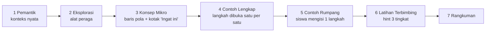

# Rancangan Belajar Mandiri — Z-Math (Bab 1 Bilangan Bulat, Kelas VII)

| | |
|---|---|
| Status | **Tidak dilanjutkan** atas permintaan pengguna (Nov 2026). Struktur yang berlaku ada di [KURIKULUM-KONTEN.md](KURIKULUM-KONTEN.md) §10. Komponen `NumberLineWalker` tetap tersedia tetapi belum dipakai |
| Cakupan | Kurikulum Merdeka Kelas VII, Bab 1 Bilangan Bulat: Submateri A, B, C |
| Di luar cakupan | **KPK dan FPB**, **Pretest/Posttest** (tidak dibuat pada tahap ini) |
| Acuan wajib | [CLAUDE.md](../CLAUDE.md) §5, [DESAIN-PEDAGOGIS.md](DESAIN-PEDAGOGIS.md) §6, [PEMODELAN-SOAL-CERITA.md](PEMODELAN-SOAL-CERITA.md) |

Dokumen ini menjawab satu pertanyaan: **bagaimana siswa bisa belajar 100% mandiri tanpa guru?** Jawabannya adalah *scaffolding* yang terpasang di aplikasi. Setiap kali siswa macet, aplikasi sudah menyiapkan langkah bantuan berikutnya. Bantuan itu tidak pernah berupa jawaban.

---

## 0. Dari Masalah ke Fitur

| Masalah siswa (studi pendahuluan) | Penyebab kognitif | Fitur yang menjawab |
|---|---|---|
| Tidak paham makna soal cerita & tidak tahu langkah awal | Beban bahasa + tidak punya skema masalah | Pemandu 4 langkah (Pahami → Ditanya → Model → Hitung & Tafsirkan), kata kunci yang bisa diketuk, petunjuk Level 1 "Makna" |
| Bingung tanda + dan − | Aturan tanda dihafal, bukan dipahami | Termometer ↔ garis bilangan real-time, **Simulasi Mobil Berjalan** (arah hadap + maju/mundur), warna tanda konsisten (biru/merah/abu) |
| Bingung urutan operasi campuran | Mengerjakan kiri-ke-kanan | Layar "kerjakan × dan : dulu" dengan penanda kurung bertahap, miskonsepsi `order_of_ops` |
| Hanya menghafal pola | Simbol diberikan sebelum makna | Urutan wajib **konkret → visual → abstrak** di setiap pelajaran (CLAUDE.md §5.3), pola ditemukan sendiri (tabel pola) |

---

## BAGIAN 1 — Alur Belajar Mandiri (User Journey 3 Modul)

### 1.1 Pola yang sama di setiap pelajaran

Setiap pelajaran memakai urutan segmen yang **sama**. Siswa jadi tahu apa yang akan datang, dan beban kognitifnya turun (*predictable structure*).



| Segmen | Tahap representasi | Format di `lessons.json` |
|---|---|---|
| Pemantik | Konkret | `hook` (+ `visual` kontekstual) |
| Eksplorasi | Konkret → visual | `explore` (`target`, `success`, `callout` "Dalam bahasa matematika") |
| Konsep Mikro | Visual → abstrak | `concept` dengan `lines` (baris pola) + `callout` |
| Contoh Lengkap | Abstrak berdampingan visual | `worked_example` |
| Contoh Rumpang | Abstrak, dibimbing | **baru**: `faded_example` (lihat 1.6) |
| Latihan | Mandiri | `practice.templates` |
| Rangkuman | Abstrak | `summary` |

**Kontrol tempo (EL3):** tidak ada auto-advance atau timer. Setiap layar punya tombol "Lanjut", "Kembali", dan "Ulangi".

### 1.2 Modul 1 — Konsep & Garis Bilangan (Submateri A)

**Tujuan:** siswa memaknai bilangan negatif, menempatkannya di garis bilangan, dan membandingkan dua bilangan bulat.

| Pelajaran | Konkret (Eksplorasi) | Visual | Abstrak (Konsep Mikro) |
|---|---|---|---|
| 1.1 Positif, Negatif, Nol | Geser **termometer** ke 5 °C lalu −3 °C | Garis bilangan muncul **sejajar** termometer dan ikut bergerak | `5 → positif`, `0 → bukan keduanya`, `−3 → negatif` |
| 1.2 Konteks Lain | Penyelam (permukaan laut = 0), lift (lantai dasar = 0) | Skala laut & gedung → tombol "Lihat sebagai garis bilangan" | Kata kunci: *di bawah, turun, basement* → negatif |
| 1.3 Garis Bilangan & Lawan | Pindahkan titik ke −4 dan 4 | Dua titik simetris terhadap 0 | `lawan dari 4 = −4` |
| 1.4 Membandingkan | Seret dua suhu kota, tebak mana lebih dingin | Panah "makin kanan, makin besar" | `−7 < −2`, `−2 < 0` |

**Latihan:** `rep-*` (menulis bilangan dari konteks) + **baru** `cmp-order` (pilih tanda <, >, =).

### 1.3 Modul 2 — Operasi Hitung & Model Matematika (Submateri B)

**Tujuan:** siswa menghitung empat operasi dan operasi campuran dengan alasan, lalu membuat model dari soal cerita.

| Pelajaran | Konkret | Visual | Abstrak |
|---|---|---|---|
| 2.1 Penjumlahan | **Mobil** menghadap kanan, maju/mundur | Lompatan di garis bilangan | Tanda sama → jumlahkan; tanda beda → kurangkan |
| 2.2 Pengurangan | Mobil **berbalik arah** untuk "−" | Lompatan + label "berbalik" | `a − b = a + (lawan b)` |
| 2.3 Perkalian | Freezer turun 2 °C tiap jam | Lompatan berulang | Tabel pola → negatif × negatif = positif |
| 2.4 Pembagian | Utang dibagi rata | Lompatan sama besar | Kebalikan perkalian |
| 2.5 Operasi Campuran | **baru**: kartu langkah "kerjakan × : dulu" | Ekspresi diberi kurung bayangan bertahap | `Kurung → × : → + −` |
| 2.6–2.9 Soal Cerita | Suhu, penyelam, lift, untung–rugi | Visual konteks | Pemandu 4 langkah + model |

**Alat peraga utama:** Simulasi Mobil Berjalan (Bagian 2.2, kode di Bagian 3).

### 1.4 Modul 3 — Pasangan Faktor (Submateri C) — **baru**

**Tujuan:** siswa memahami faktor sebagai **ukuran persegi panjang**. Siswa menemukan semua pasangan faktor positif, lalu memperluasnya ke pasangan faktor negatif. Modul ini **tanpa KPK/FPB**.

| Pelajaran | Konkret | Visual | Abstrak |
|---|---|---|---|
| 3.1 Apa itu Faktor? | Susun 12 kursi menjadi barisan rapi | **Grid ubin**: 3 baris × 4 kursi | `12 = 3 × 4` → 3 dan 4 adalah faktor 12 |
| 3.2 Mencari Semua Pasangan | Coba 1, 2, 3, … baris; lihat mana yang pas tanpa sisa | Grid menandai "sisa" berwarna abu bila tidak pas | `1 × 12`, `2 × 6`, `3 × 4` → faktor: 1, 2, 3, 4, 6, 12 |
| 3.3 Pasangan Faktor Negatif | Ingat tabel pola perkalian (Modul 2) | Pasangan positif di samping cerminannya | `(−3) × (−4) = 12`, maka −3 dan −4 juga faktor 12 |
| 3.4 Bilangan Prima & Faktor 1 | Bilangan yang hanya punya 1 susunan | Grid hanya bisa 1 baris | `7 = 1 × 7` saja |

**Catatan konsep:** ubin dan kursi hanya bisa menggambarkan bilangan **positif**. Pasangan negatif diturunkan dari aturan tanda (Modul 2.3), bukan dari grid. Ini disampaikan terang-terangan di layar 3.3 agar tidak muncul miskonsepsi.

### 1.5 Latihan Terbimbing — Hint Bertahap (Scaffolding 1–2–3)

Bagian ini mengikuti kebijakan [DESAIN-PEDAGOGIS.md](DESAIN-PEDAGOGIS.md) §6. Petunjuk **tidak pernah** menyebut hasil akhir. Generator petunjuk hanya menerima `HintView` yang tidak memuat jawaban, dan setiap jenis soal baru wajib lolos `test_hints_no_leak.py`.

| Level | Nama | Isi | Contoh: 3 − (−5) | Contoh: faktor 18 |
|---|---|---|---|---|
| 1 | **Makna** | Menghidupkan konsep, tanpa angka hasil | "Mengurangi sama dengan menambah lawannya." | "Faktor adalah banyak baris yang membuat 18 kursi tersusun rapi tanpa sisa." |
| 2 | **Visual** | Alat peraga mode `hint`: arah saja, tanpa posisi akhir | Mobil di 3, menghadap kiri, panah "mundur 5" → `?` | Grid 18 ubin dengan baris 1 dan 2 sudah terisi; baris 3 masih kosong |
| 3 | **Strategi** | Kerangka dengan kotak kosong | `3 − (−5) = 3 + □` | `18 = 1 × 18`, `2 × □`, `3 × □` |

**Jika masih macet:** salah 2× setelah Level 3 → **Soal Kembar** (konteks & angka berbeda, dikerjakan lengkap) → bila masih salah → **Antrean Ulang** (muncul lagi dengan angka baru). Pembahasan hanya muncul setelah siswa menjawab benar.

**Umpan balik miskonsepsi baru** (tanpa menyebut jawaban, tanpa angka):

| Kode | Pemicu | Pesan |
|---|---|---|
| `walk_direction` | Prediksi ke arah berlawanan | "Cek arah mobilnya: maju atau mundur? Menghadap ke mana?" |
| `factor_missing_pair` | Daftar faktor kurang satu pasangan | "Setiap faktor punya pasangan. Coba cek lagi pasangannya." |
| `factor_not_divisor` | Memilih bukan faktor | "Coba susun ubinnya. Apakah ada sisa?" |
| `factor_sign` | Lupa pasangan negatif (di soal 3.3) | "Ingat: negatif kali negatif juga positif." |

### 1.6 Contoh Rumpang (*faded example*) — segmen baru

Jembatan antara contoh lengkap dan latihan (GL2–GL3). Langkah 1–2 ditampilkan, langkah 3 dikosongkan untuk diisi siswa. Format usulan:

```json
{
  "type": "faded_example",
  "problem": "(−4) + 9 = ?",
  "steps": [
    { "text": "Mulai di **−4**.", "why": "Bilangan pertama = posisi awal." },
    { "text": "Maju **9** langkah ke kanan.", "why": "9 positif, mobil maju." },
    { "blank": true, "answer_check": "result", "prompt": "Di mana mobil berhenti?" }
  ]
}
```

Jawaban langkah rumpang **diperiksa di server** (seperti latihan). Kunci jawaban tidak dikirim ke klien.

---

## BAGIAN 2 — Spesifikasi Alat Peraga Digital Interaktif

Semua alat peraga mematuhi aturan berikut:
- Memakai antarmuka `VisualScript` yang sama (CLAUDE.md §5.3). Bentuk yang berlaku adalah versi kode di `frontend/src/lib/types.ts` (`marks`, `arrows`, `pointer`, `mode`).
- Warna tanda tetap: biru = positif, merah = negatif, abu = nol. Oranye hanya untuk aksi atau penunjuk.
- Label diletakkan langsung di gambar (*spatial contiguity*).
- Bisa dipakai dengan sentuhan dan keyboard, dengan target sentuh ≥ 44 px dan teks alternatif `aria-label`.
- Hormati `prefers-reduced-motion`.
- Mode `hint` **tidak pernah** menggambar posisi akhir.

### 2.1 Termometer & Garis Bilangan Interaktif (Slider SVG)

**Tujuan:** siswa melihat bahwa "naik/turun" di termometer **sama** dengan "kanan/kiri" di garis bilangan.

| Aspek | Spesifikasi |
|---|---|
| Komponen | `ThermoLine.tsx`. Menyusun `VerticalScale` (skin `thermometer`) dan `NumberLine` yang sudah ada, berdampingan dalam satu `<figure>` |
| State | `value: number` (satu sumber), `range: [lo, hi]`, `step` |
| Input | (1) Seret cairan termometer (pointer events), (2) tombol ▲▼, (3) keyboard ↑↓ / ←→, (4) `<input type="range">` tersembunyi untuk pembaca layar |
| Pemetaan | `y = bottom − (value − lo) / (hi − lo) × height` (vertikal) dan `x = left + (value − lo) / (hi − lo) × width` (horizontal). Keduanya dari `value` yang sama, jadi selalu sinkron |
| Umpan balik real-time | Label nilai di ujung cairan dan di titik garis bilangan, berwarna sesuai tanda. Garis putus-putus menghubungkan "0 °C" termometer ke "0" garis bilangan |
| Mode `explore` | Bebas bergerak. Jika `target` tercapai → pesan `success` |
| Mode `answer` | Siswa menunjuk hasil → `onAnswer(value)` → diperiksa server |
| Mode `hint` | Posisi awal + panah arah saja, tanpa label posisi akhir |
| Snap | `Math.round(raw / step) * step`, di-*clamp* ke `range` |
| Uji | `valueToY`/`valueToX` dan `snap` sebagai fungsi murni (Vitest) |

```ts
type ThermoLineProps = {
  script: VisualScript;          // kind: 'thermometer', mode, range, marks, target
  target?: number;               // explore: nilai yang dicari
  onChange?: (value: number) => void;
  onAnswer?: (value: number) => void;
};
```

### 2.2 Simulasi Mobil Berjalan (penjumlahan & pengurangan)

**Model mental yang dipakai** (konsisten dengan "mengurangi = menambah lawan"):

| Operasi | Arah hadap mobil | Bilangan kedua positif | Bilangan kedua negatif |
|---|---|---|---|
| `a + b` | Menghadap **kanan** (arah positif) | **Maju** → ke kanan | **Mundur** → ke kiri |
| `a − b` | **Berbalik**, menghadap **kiri** | **Maju** → ke kiri | **Mundur** → ke kanan |

| Aspek | Spesifikasi |
|---|---|
| Komponen | `NumberLineWalker.tsx` (kode lengkap di Bagian 3) + logika murni `walk.ts` |
| State | `start`, `op`, `operand`, `phase: 'setup' \| 'predict' \| 'walking' \| 'done'`, `taken` (langkah yang sudah dijalani), `guess` |
| Alur | **Atur** soal → **Tebak** hasil (boleh dilewati) → **Jalankan** langkah demi langkah (setiap ketukan = 1 langkah) atau "Selesaikan" → **Bandingkan** tebakan |
| Animasi | Posisi mobil berpindah dengan transisi CSS 250 ms per langkah. Mobil membalik (`scale(-1,1)`) saat menghadap kiri. Tidak ada animasi yang berjalan sendiri: tempo dipegang siswa |
| Penjelasan instan | Setiap fase menampilkan 1 kalimat: arah hadap, maju/mundur, lalu kalimat matematika `(−3) − (−5) = 2` setelah selesai |
| Umpan balik tebakan | `correct`, `wrong_direction` (tebakan bergerak ke arah sebaliknya), `wrong_distance` (arah benar, jarak salah), `other` |
| Batas | Posisi selalu di `[-15, 15]`. Pilihan bilangan yang membuat mobil keluar garis dinonaktifkan |
| Pemakaian | Segmen `explore` di Pelajaran 2.1–2.2, dan **Petunjuk Level 2** untuk soal `ADD`/`SUB` (mode `hint`: mobil di posisi awal, arah hadap + panah tanpa ujung) |

### 2.3 Grid/Ubin Penyusun Pasangan Faktor

**Tujuan:** siswa menemukan faktor dengan menyusun `n` ubin menjadi persegi panjang tanpa sisa.

| Aspek | Spesifikasi |
|---|---|
| Komponen | `FactorGrid.tsx` + logika murni `factors.ts` |
| State | `n` (jumlah ubin, 2–36), `rows` (banyak baris pilihan siswa), `found: Array<[number, number]>` (pasangan yang sudah ditemukan) |
| Interaksi | Stepper "Banyak baris" (− / +) atau seret sudut grid. Ubin otomatis mengisi baris demi baris |
| Logika | `cols = Math.ceil(n / rows)`, `remainder = rows × cols − n`. Jika `n % rows === 0` → grid persegi panjang sempurna (bingkai oranye, tombol "Simpan pasangan"). Jika tidak → baris terakhir pendek, slot kosong diberi garis putus-putus dan label "sisa" |
| Pasangan | Menyimpan `[rows, cols]` sekaligus `[cols, rows]` (sifat tukar). Daftar faktor tersusun otomatis: `1, 2, 3, 4, 6, 12` |
| Pasangan negatif | Setelah semua pasangan positif ditemukan, muncul kartu "Bagaimana dengan negatif?" yang menampilkan `(−3) × (−4) = 12` di samping grid `3 × 4`. Grid **tidak** menggambar ubin negatif |
| Mode `hint` | Level 2: grid dengan pasangan kecil sudah terisi; pasangan berikutnya kosong |
| Selesai | `found` lengkap → umpan balik "Semua pasangan faktor 12 sudah kamu temukan!" + jumlah faktor |
| Kursi (konteks) | *Skin* opsional `chair`: ubin diganti ikon kursi, logika sama |
| Uji | `factorPairs(n)`, `isRectangle(n, rows)`, `remainder(n, rows)` sebagai fungsi murni |

```ts
// factors.ts (murni, wajib unit test)
export const factorPairs = (n: number): Array<[number, number]> => /* [1,n], [2,n/2], … sampai √n */;
export const isRectangle = (n: number, rows: number) => rows > 0 && n % rows === 0;
export const signedFactors = (n: number) => /* ±f untuk setiap faktor positif f */;
```

---

## BAGIAN 3 — Kode Reusable: Simulasi Garis Bilangan Operasi Hitung

Sudah diimplementasikan di repositori:

| File | Isi |
|---|---|
| `frontend/src/features/visuals/walk.ts` | Logika murni: `planWalk`, `positionAfter`, `walkFeedback`, `operandChoices` |
| `frontend/src/features/visuals/walk.test.ts` | Unit test (Vitest) |
| `frontend/src/features/visuals/NumberLineWalker.tsx` | Komponen React + Tailwind (state, langkah mobil, penjelasan instan) |
| `frontend/src/features/visuals/NumberLine.tsx` | Ditambah prop opsional `character` untuk menggambar mobil yang menghadap kiri/kanan |
| `frontend/src/i18n/id.ts` | Semua teks (`t.walker`) |

Cara pakai:

```tsx
import { NumberLineWalker } from '../visuals/NumberLineWalker';

<NumberLineWalker initialStart={-3} initialOp="-" initialOperand={-5} />
```

Komponen ini **tidak** memberi jawaban latihan. Komponen ini adalah alat eksplorasi: siswa melihat hasilnya **sesudah** menjalankan mobil sendiri. Untuk latihan bernilai, pakai mode `hint` lewat `visual_script.py` (posisi akhir tidak pernah dikirim).

---

## 4. Rencana Migrasi dari Struktur Sekarang

| Sekarang (10 pelajaran) | Usulan 3 modul |
|---|---|
| M1 `m1-t1`, `m1-t2` | **Modul 1**: 1.1, 1.3 (+ baru 1.2 konteks lain, 1.4 membandingkan) |
| M3 `m3-t1`, `m3-t2` | **Modul 2**: 2.1, 2.2 (ditambah Simulasi Mobil) |
| M4 `m4-t1`, `m4-t2` | **Modul 2**: 2.3, 2.4 |
| — | **Modul 2**: 2.5 Operasi Campuran (baru; template `MIX` sudah ada di bank ujian) |
| M6 `m6-t1`…`m6-t4` | **Modul 2**: 2.6–2.9 Soal Cerita |
| — | **Modul 3**: 3.1–3.4 Faktor (baru: template `FCT`, `FactorGrid`) |
| Ujian Akhir (F-23) | Tetap, ditambah 1 slot Faktor pada tahap Dasar/Menengah |

Urutan kerja yang disarankan (perubahan kecil dan bertahap):
1. `NumberLineWalker` masuk ke segmen `explore` Pelajaran Penjumlahan/Pengurangan. ✅ komponen siap.
2. `ThermoLine` menggantikan dua segmen eksplorasi terpisah di Modul 1.
3. `factors.ts` + `FactorGrid` + template `FCT` + `hint_generator` cabang `FCT` + test tanpa bocor.
4. Ubah `modules.json` menjadi 3 modul. Nomor pelajaran global (`number`) ikut menyesuaikan otomatis.
5. Segmen `faded_example` (butuh endpoint pemeriksa langkah).

## 5. Keputusan yang Perlu Dikonfirmasi

1. **Struktur 3 modul** menggantikan M1/M3/M4/M6 di [KURIKULUM-KONTEN.md](KURIKULUM-KONTEN.md)? Jika ya, progres siswa lama tetap aman karena ID pelajaran tidak berubah.
2. **Pretest/Posttest**: permintaan ini meniadakannya, tetapi [PRD.md](PRD.md) masih memuat F-03 (cek prasyarat) dan pre/post-test untuk evaluasi penelitian (G2, §metrik). Apakah F-03 ditunda dan pre/post-test dilakukan di luar aplikasi?
3. **Ujian Akhir (F-23)** bukan posttest penelitian (tetap ada petunjuk, tidak dipakai untuk nilai rapor). Apakah tetap dipertahankan?
4. **Model "mobil berbalik arah"** untuk pengurangan adalah representasi baru di samping "menambah lawan". Keduanya dikaitkan di layar yang sama. Mohon konfirmasi sesuai DESAIN-PEDAGOGIS (CLAUDE.md §9).
5. **Ketidaksesuaian dokumen vs kode**: [VISUALISASI.md](VISUALISASI.md) §3 menulis `VisualScript` dengan `start`/`steps`, sedangkan kode memakai `marks`/`arrows`/`pointer`. Rancangan ini mengikuti kode. Apakah VISUALISASI.md diperbarui mengikuti kode?
