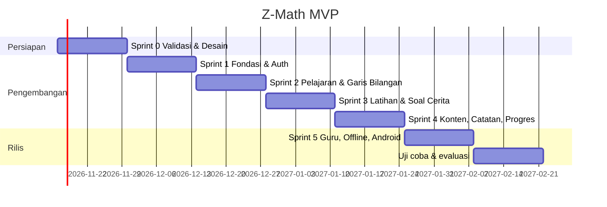

# Roadmap Pengembangan — Z-Math MVP

**Durasi:** 12 minggu (6 sprint × 2 minggu), perkiraan mulai Senin, 16 November 2026.
**Metode:** Scrum ringan dengan backlog di GitHub Projects. Setiap issue diberi label ID fitur (`F-xx`).

## 1. Timeline

> Perhatikan libur akhir tahun (akhir Desember sampai awal Januari). Sesuaikan tanggal dengan kalender akademik.

## 2. Rincian Sprint

### Sprint 0 — Validasi & Desain (16–29 Nov 2026)
| Tugas | Output |
|---|---|
| Wawancara tambahan 3–5 siswa + 1 guru | Matriks temuan yang diperbarui |
| Wireframe lo-fi + uji think-aloud (3 siswa) | Figma lo-fi, catatan uji |
| Finalisasi konten M1 & M3 bersama guru | File JSON konten draf |
| Setup repo, Supabase project, CI | Repo + pipeline lint/test |
**Milestone:** PRD v1.1 disetujui (dosen/pembimbing).

### Sprint 1 — Fondasi & Autentikasi (30 Nov – 13 Des)
| Tugas | Fitur |
|---|---|
| Scaffold frontend (Vite, Tailwind, Router, i18n, tokens) | — |
| Scaffold backend (FastAPI, config, security, health) | — |
| Migrasi DB `0001_init.sql` + RLS + trigger profil | — |
| Login/registrasi, sesi, profil | F-01 |
| Buat & gabung kelas | F-02 |
| Cek prasyarat + remedial | F-03 |
**Demo:** siswa dapat mendaftar, bergabung ke kelas, dan mengerjakan cek prasyarat.

### Sprint 2 — Pelajaran & Garis Bilangan (14–27 Des)
| Tugas | Fitur |
|---|---|
| Komponen `NumberLine` (SVG, drag, animasi per langkah, a11y) + antarmuka `VisualScript` | F-05 |
| Komponen `Thermometer` dan `Counters` (keping +/−) | F-19 |
| `LessonPlayer` + renderer segmen (hook, explore, concept, worked, faded, summary) | F-04, F-08 |
| Simpan posisi segmen (progress) | F-04 |
| Konten M1 & M2 | — |
**Rilis Alpha** (internal).

### Sprint 3 — Latihan & Soal Cerita (28 Des – 10 Jan)
| Tugas | Fitur |
|---|---|
| Mesin pemodelan: `schema`, `instantiate`, `model_builder`, `solver`, `equivalence` + test properti | F-09, F-20 |
| `hint_generator` 3 tingkat + test "tanpa bocor" di CI | F-10 |
| `twin.py` (Soal Kembar) + `review_queue` | F-10 |
| `grader.py` + `misconceptions.py` + test | F-10 |
| Endpoint `/practice/*` (steps, hint, twin, review-queue) | F-09, F-10 |
| UI `PracticeSession`, `HintPanel` bertumpuk, `TwinExample`, `Feedback` | F-10 |
| `StoryGuide` 4 langkah (+ Tafsirkan) + `KeywordHighlighter` + `ExpressionBuilder` | F-06, F-07, F-20 |
| Visual `SeaDepth`, `Elevator` | F-19 |
| Level adaptif + rotasi posisi yang tidak diketahui | F-09, F-20 |

### Sprint 4 — Konten, Catatan, Progres (11–24 Jan 2027)
| Tugas | Fitur |
|---|---|
| Konten M3–M6 (skema semantik 8 jenis soal + Soal Kembar) + review guru | F-20 |
| Visual `Wallet`, `Scoreboard`, `Elevation`, `DataLineChart` | F-19 |
| Misi Literasi: `MissionPlayer`, `StimulusPanel`, tugas penalaran + 6 misi | F-21 |
| Catatanku (CRUD via supabase-js, salin contoh) | F-11 |
| Peta modul & perhitungan mastery | F-12 |
| Kuesioner beban kognitif | F-14 |
**Rilis Beta** (uji terbatas 5 siswa).

### Sprint 5 — Guru, Offline, Android (25 Jan – 7 Feb 2027)
| Tugas | Fitur |
|---|---|
| Dasbor guru (overview + miskonsepsi + literasi + soal ditunda) | F-13 |
| PWA: precache, offline queue, sinkronisasi | F-15 |
| Capacitor Android: build APK, plugin, deep link Google login | — |
| Uji perangkat low-end, perbaikan performa | NFR |
| Lencana sederhana (jika waktu cukup) | F-17 |
**Rilis MVP:** web (Vercel) + APK.

### Sprint 6 — Uji Coba & Evaluasi (8–21 Feb 2027)
| Tugas | Output |
|---|---|
| Pre-test (konsep + literasi) → pemakaian 2 pertemuan → post-test | Data N-gain konsep & literasi |
| Kuesioner beban kognitif & SUS | Data CL & SUS |
| Wawancara pasca-uji (3–5 siswa) | Temuan kualitatif |
| Perbaikan bug kritis | Rilis 1.0.1 |
| Laporan akhir | Dokumen laporan |

## 3. Milestone dan Deliverable

| Milestone | Tanggal | Deliverable |
|---|---|---|
| M-0 Perencanaan selesai | 29 Nov 2026 | Dokumen `docs/` v1.1, wireframe |
| M-1 Alpha | 27 Des 2026 | Auth, prasyarat, pelajaran M1–M2, garis bilangan |
| M-2 Beta | 24 Jan 2027 | Latihan, soal cerita, seluruh konten, catatan |
| M-3 MVP | 7 Feb 2027 | Dasbor guru, offline, APK Android |
| M-4 Evaluasi | 21 Feb 2027 | Data uji coba + laporan |

## 4. Backlog Pasca-MVP

- F-16 Fitur "Tanya Teman" (berbagi catatan antar teman sekelas)
- F-22 Pemodel Bebas (parser soal cerita bahasa Indonesia). Jika ada waktu sisa di Sprint 5, mulai dengan versi pembangun model manual
- Materi Pecahan, lalu Aljabar
- Penugasan latihan oleh guru dengan tenggat
- Rilis Google Play (production track)
- Dukungan iOS (Capacitor)
- Narasi audio untuk segmen (opsional, menghindari redundancy effect)

## 5. Manajemen Risiko Jadwal

| Jika… | Maka… |
|---|---|
| Sprint 3 terlambat | Tunda F-14 dan F-17, prioritaskan F-06, F-10, F-20 |
| Konten 8 jenis soal terlalu banyak | MVP cukup CHG, CMP, CMB, RPT (paling sering di buku). PRT, SCR, AVG, MLT menyusul |
| Misi Literasi belum lengkap | Minimal 3 misi (M2, M3, M6) untuk uji coba |
| Konten belum diulas guru | Rilis Beta hanya dengan M1–M3 |
| Build Android bermasalah | Uji coba memakai PWA ("Tambahkan ke layar utama") |
