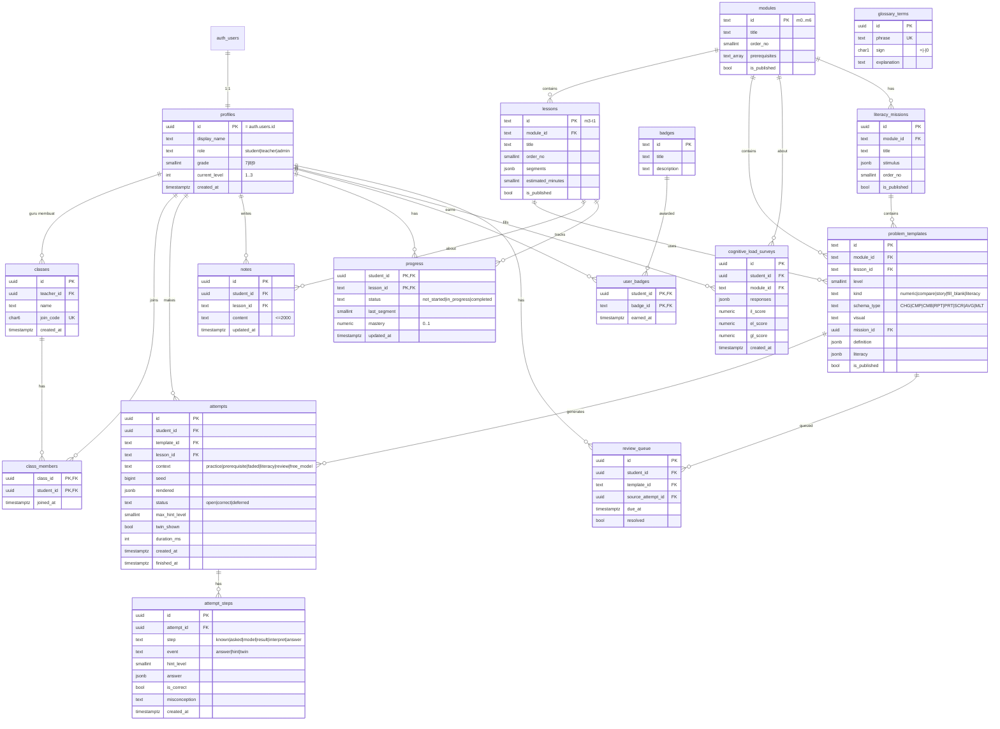

# Skema Database — Z-Math (Supabase / PostgreSQL)

## 1. ERD



## 2. Definisi Tabel (SQL)

File migrasi: `supabase/migrations/0001_init.sql`

```sql
-- ===== Enum =====
create type user_role as enum ('student', 'teacher', 'admin');
create type progress_status as enum ('not_started', 'in_progress', 'completed');
-- Tidak ada status "revealed": jawaban tidak pernah diungkap (kebijakan F-10).
create type attempt_status as enum ('open', 'correct', 'deferred');

-- ===== Profil =====
create table profiles (
  id             uuid primary key references auth.users(id) on delete cascade,
  display_name   text not null check (char_length(display_name) between 2 and 40),
  role           user_role not null default 'student',
  grade          smallint check (grade between 7 and 9),
  current_level  smallint not null default 1 check (current_level between 1 and 3),
  created_at     timestamptz not null default now()
);

-- ===== Kelas =====
create table classes (
  id          uuid primary key default gen_random_uuid(),
  teacher_id  uuid not null references profiles(id) on delete cascade,
  name        text not null,
  join_code   char(6) not null unique,
  created_at  timestamptz not null default now()
);

create table class_members (
  class_id    uuid references classes(id) on delete cascade,
  student_id  uuid references profiles(id) on delete cascade,
  joined_at   timestamptz not null default now(),
  primary key (class_id, student_id)
);

-- ===== Konten =====
create table modules (
  id             text primary key,
  title          text not null,
  order_no       smallint not null,
  prerequisites  text[] not null default '{}',
  is_published   boolean not null default false
);

create table lessons (
  id                 text primary key,
  module_id          text not null references modules(id),
  title              text not null,
  order_no           smallint not null,
  segments           jsonb not null,
  estimated_minutes  smallint,
  is_published       boolean not null default false
);

create table literacy_missions (
  id            uuid primary key default gen_random_uuid(),
  module_id     text not null references modules(id),
  title         text not null,
  stimulus      jsonb not null,           -- teks/tabel/grafik, lihat KURIKULUM-KONTEN.md §5.4
  order_no      smallint not null default 1,
  is_published  boolean not null default false
);

create table problem_templates (
  id            text primary key,
  module_id     text not null references modules(id),
  lesson_id     text references lessons(id),
  mission_id    uuid references literacy_missions(id),
  level         smallint not null check (level between 1 and 3),
  kind          text not null check (kind in ('numeric','compare','story','fill_blank','literacy')),
  schema_type   text check (schema_type in ('CHG','CMP','CMB','RPT','PRT','SCR','AVG','MLT')),
  visual        text,                     -- number_line, thermometer, sea_depth, elevator, ...
  definition    jsonb not null,           -- skema semantik, lihat PEMODELAN-SOAL-CERITA.md §3
  literacy      jsonb not null default '{}',  -- {indicators:[LM..], process, cognitive_level, akm_context}
  is_published  boolean not null default false
);

create table glossary_terms (
  id           uuid primary key default gen_random_uuid(),
  phrase       text not null unique,
  sign         char(1) not null check (sign in ('+','-','0')),
  explanation  text not null
);

-- ===== Aktivitas siswa =====
create table attempts (
  id           uuid primary key default gen_random_uuid(),
  student_id   uuid not null references profiles(id) on delete cascade,
  template_id  text not null references problem_templates(id),
  lesson_id    text references lessons(id),
  context      text not null default 'practice'
               check (context in ('practice','prerequisite','faded','literacy','review','free_model')),
  seed         bigint not null,
  rendered     jsonb not null,            -- teks soal yang ditampilkan (tanpa jawaban)
  status       attempt_status not null default 'open',
  max_hint_level smallint not null default 0 check (max_hint_level between 0 and 3),
  twin_shown   boolean not null default false,
  duration_ms  integer,
  created_at   timestamptz not null default now(),
  finished_at  timestamptz
);
create index on attempts (student_id, created_at desc);

create table attempt_steps (
  id             uuid primary key default gen_random_uuid(),
  attempt_id     uuid not null references attempts(id) on delete cascade,
  step           text not null check (step in ('known','asked','model','result','interpret','answer')),
  event          text not null default 'answer' check (event in ('answer','hint','twin')),
  hint_level     smallint check (hint_level between 1 and 3),   -- diisi jika event = 'hint'
  answer         jsonb,                   -- null untuk event hint/twin
  is_correct     boolean,                 -- null untuk event hint/twin
  misconception  text,                    -- sign_error, abs_sum, sub_negative, mult_sign, compare_order
  created_at     timestamptz not null default now()
);
create index on attempt_steps (attempt_id);

-- Antrean Ulang: soal yang ditunda muncul lagi (angka berbeda) di sesi berikutnya
create table review_queue (
  id                 uuid primary key default gen_random_uuid(),
  student_id         uuid not null references profiles(id) on delete cascade,
  template_id        text not null references problem_templates(id),
  source_attempt_id  uuid references attempts(id) on delete set null,
  due_at             timestamptz not null default now() + interval '1 day',
  resolved           boolean not null default false,
  created_at         timestamptz not null default now()
);
create index on review_queue (student_id, resolved, due_at);

create table notes (
  id          uuid primary key default gen_random_uuid(),
  student_id  uuid not null references profiles(id) on delete cascade,
  lesson_id   text not null references lessons(id),
  content     text not null check (char_length(content) <= 2000),
  updated_at  timestamptz not null default now(),
  unique (student_id, lesson_id)
);

create table progress (
  student_id    uuid references profiles(id) on delete cascade,
  lesson_id     text references lessons(id),
  status        progress_status not null default 'not_started',
  last_segment  smallint not null default 0,
  mastery       numeric(3,2) not null default 0 check (mastery between 0 and 1),
  updated_at    timestamptz not null default now(),
  primary key (student_id, lesson_id)
);

create table badges (
  id           text primary key,
  title        text not null,
  description  text not null
);

create table user_badges (
  student_id  uuid references profiles(id) on delete cascade,
  badge_id    text references badges(id),
  earned_at   timestamptz not null default now(),
  primary key (student_id, badge_id)
);

create table cognitive_load_surveys (
  id          uuid primary key default gen_random_uuid(),
  student_id  uuid not null references profiles(id) on delete cascade,
  module_id   text not null references modules(id),
  responses   jsonb not null,             -- {"q1": 0..10, ..., "q10": 0..10}
  il_score    numeric(4,2),
  el_score    numeric(4,2),
  gl_score    numeric(4,2),
  created_at  timestamptz not null default now()
);
```

### Trigger: membuat profil otomatis saat registrasi
```sql
create function handle_new_user() returns trigger
language plpgsql security definer set search_path = public as $$
begin
  insert into profiles (id, display_name)
  values (new.id, coalesce(new.raw_user_meta_data->>'display_name', 'Siswa'));
  return new;
end; $$;

create trigger on_auth_user_created
  after insert on auth.users
  for each row execute function handle_new_user();
```

## 3. Row Level Security (RLS)

Semua tabel: `alter table <nama> enable row level security;`

| Tabel | Siswa | Guru | Admin | Backend (service role) |
|---|---|---|---|---|
| profiles | baca/ubah milik sendiri (kecuali `role`) | baca profil siswa di kelasnya | semua | semua |
| classes | baca kelas yang diikuti | CRUD kelas milik sendiri | semua | semua |
| class_members | baca milik sendiri; gabung lewat API | baca anggota kelasnya | semua | semua |
| modules, lessons, glossary_terms | baca yang `is_published` | baca | CRUD | semua |
| problem_templates | **tidak ada akses** (berisi kunci jawaban) | tidak | CRUD | semua |
| literacy_missions | baca yang `is_published` (stimulus saja) | baca | CRUD | semua |
| review_queue | baca milik sendiri | baca agregat lewat API | semua | semua |
| attempts, attempt_steps | baca milik sendiri; tulis lewat API | baca agregat lewat API | semua | semua |
| notes | CRUD milik sendiri | **tidak ada akses** (privasi) | tidak | tidak dipakai |
| progress | baca milik sendiri | baca siswa di kelasnya | semua | semua |
| cognitive_load_surveys | insert milik sendiri | tidak | baca/ekspor | semua |

Contoh kebijakan:
```sql
-- Siswa hanya bisa mengelola catatan sendiri
create policy notes_owner on notes
  for all using (auth.uid() = student_id) with check (auth.uid() = student_id);

-- Konten yang dipublikasikan dapat dibaca pengguna yang login
create policy lessons_read on lessons
  for select to authenticated using (is_published);

-- Guru dapat membaca progres siswa di kelasnya
create policy progress_teacher_read on progress
  for select using (
    auth.uid() = student_id
    or exists (
      select 1 from class_members cm
      join classes c on c.id = cm.class_id
      where cm.student_id = progress.student_id and c.teacher_id = auth.uid()
    )
  );

-- Pengguna boleh mengubah profil sendiri...
create policy profiles_self_update on profiles
  for update using (auth.uid() = id) with check (auth.uid() = id);

-- ...tetapi kolom role tidak boleh diubah dari klien (hanya backend/admin via service role).
-- Memakai hak akses kolom, bukan subquery ke profiles, agar tidak terjadi rekursi RLS.
revoke update on profiles from authenticated;
grant update (display_name, grade) on profiles to authenticated;
```

## 4. Perhitungan `mastery`

`mastery` per pelajaran = rata-rata tertimbang 10 percobaan terakhir (sesuai [DESAIN-PEDAGOGIS.md](DESAIN-PEDAGOGIS.md) §6.4):
- benar tanpa petunjuk = 1,0
- benar, petunjuk tertinggi = 1 → 0,8
- benar, petunjuk tertinggi = 2 → 0,6
- benar, petunjuk tertinggi = 3 → 0,4
- benar setelah Soal Kembar (`twin_shown`) = 0,2
- `deferred` (ditunda ke Antrean Ulang) = 0

Skor literasi per indikator LM dihitung dari jawaban pada soal yang memiliki tag `literacy.indicators`, dengan bobot yang sama.

Pelajaran berstatus `completed` jika semua segmen sudah dilalui **dan** `mastery ≥ 0,7`.

## 5. Retensi Data

- Data `attempts` dan `attempt_steps` disimpan selama periode penelitian, lalu dianonimkan (`student_id` diganti hash).
- Akun yang dihapus menghapus semua data terkait (`on delete cascade`).
