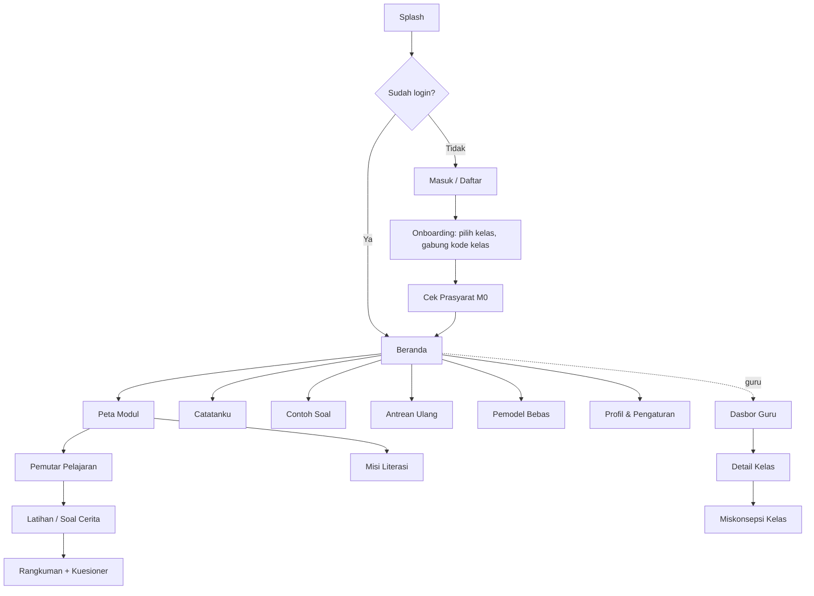

# Desain UI/UX — Z-Math

## 1. Prinsip Antarmuka Rendah Beban Kognitif

| # | Prinsip | Aturan konkret |
|---|---|---|
| 1 | **Satu fokus per layar** | Satu konsep, satu pertanyaan, atau satu langkah per layar |
| 2 | **Siswa memegang kendali tempo** | Tanpa auto-advance. Tombol "Lanjut" besar di bawah, "Kembali" dan "Ulangi" selalu ada |
| 3 | **Navigasi yang dapat diprediksi** | Posisi tombol sama di semua layar pelajaran |
| 4 | **Warna bermakna (signaling)** | Biru = positif, merah = negatif, abu-abu = nol, hijau = benar, oranye = coba lagi. Tanda +/− tetap ditulis (aksesibel bagi buta warna) |
| 5 | **Teks pendek** | ≤ 60 kata per segmen, kalimat ≤ 15 kata, font isi ≥ 16 px (soal ≥ 18 px) |
| 6 | **Label menempel pada visual** | Angka dan label langsung di garis bilangan, bukan di legenda terpisah |
| 7 | **Tanpa gangguan** | Tidak ada iklan, pop-up, atau maskot animasi saat sedang mengerjakan |
| 8 | **Umpan balik segera dan ramah** | Muncul di dekat jawaban, maksimal 2 kalimat, tanpa kata "SALAH!" |
| 9 | **Mobile-first** | Dirancang untuk lebar 360 px, target sentuh ≥ 44 px, area tombol utama di jangkauan ibu jari |
| 10 | **Bimbing, jangan beri jawaban** | Tidak ada tombol "Lihat Jawaban". Petunjuk 3 tingkat bertumpuk, Soal Kembar, lalu Antrean Ulang ([DESAIN-PEDAGOGIS.md](DESAIN-PEDAGOGIS.md) §6) |

## 2. Design Tokens

```css
:root {
  /* Makna matematika */
  --color-positive: #1D4ED8;   /* biru 700 */
  --color-negative: #DC2626;   /* merah 600 */
  --color-zero:     #6B7280;   /* abu-abu 500 */

  /* Status */
  --color-correct:  #15803D;   /* hijau 700 */
  --color-retry:    #C2410C;   /* oranye 700 */
  --color-hint:     #7C3AED;   /* ungu 600 */

  /* Netral */
  --color-bg:       #F8FAFC;
  --color-surface:  #FFFFFF;
  --color-text:     #0F172A;
  --color-muted:    #475569;

  /* Tipografi */
  --font-sans: "Nunito", "Segoe UI", system-ui, sans-serif;
  --font-math: "Atkinson Hyperlegible", var(--font-sans);
  --text-body: 1rem;      /* 16px */
  --text-problem: 1.125rem; /* 18px */
  --text-title: 1.5rem;

  --radius: 12px;
  --space: 8px;
}
```

Mode gelap disediakan dengan kontras tetap ≥ 4,5:1.

## 3. Sitemap



Navigasi bawah (siswa): **Beranda · Belajar · Catatanku · Profil**

## 4. Wireframe Layar Utama

### 4.1 Beranda (siswa)
```
┌──────────────────────────────┐
│ Hai, Raka 👋                  │
│ Lanjutkan belajar:            │
│ ┌──────────────────────────┐ │
│ │ M3 · Penjumlahan &        │ │
│ │ Pengurangan               │ │
│ │ ███████░░░  3 dari 7      │ │
│ │        [ Lanjutkan ▶ ]    │ │
│ └──────────────────────────┘ │
│ 💡 Saran: Ulang perkalian     │
│    (dari Cek Prasyarat)       │
│ Progres kamu: 54%             │
├──────────────────────────────┤
│ 🏠 Beranda 📚 Belajar 📝 Catatan 👤 │
└──────────────────────────────┘
```

### 4.2 Pemutar Pelajaran (segmen eksplorasi)
```
┌──────────────────────────────┐
│ ← M3.1 Penjumlahan     3 / 7 │
│ ●●●○○○○                      │
│                              │
│ Mulai dari −2.               │
│ Ketuk ➡ sebanyak 5 kali.     │
│                              │
│  ◀━━┿━━┿━━┿━━┿━━┿━━┿━━┿━━▶   │
│   −4 −3 −2 −1  0  1  2  3    │
│         ●═══╗╗╗╗╗            │
│          (merah) (biru)      │
│                              │
│    [ ⬅ ]   [ ↺ Ulangi ]   [ ➡ ] │
│                              │
│ 📝 Catat        [ Lanjut ▶ ] │
└──────────────────────────────┘
```

### 4.3 Soal Cerita: Pemandu 4 Langkah
```
┌──────────────────────────────┐
│ ← Soal Cerita       Level 1  │
│ ①Pahami ②Ditanya ③Model ④Hitung │
│ ━━━━━━━                      │
│ Seorang penyelam berada 4 m  │
│ [di bawah permukaan laut].   │
│ Ia menyelam 3 m [lebih dalam]│
│ Di kedalaman berapa ia kini? │
│                              │
│ ① Apa yang diketahui?        │
│ Ketuk angka yang benar:      │
│  ( 4 ) ( −4 ) ( 3 ) ( −3 )   │
│                              │
│ ┌ 🔎 di bawah permukaan laut ┐│
│ │ = bilangan negatif (−)    ││
│ └───────────────────────────┘│
│ [ 💡 Petunjuk ]  [ Periksa ] │
└──────────────────────────────┘
```

### 4.4 Umpan Balik (tanpa jawaban)
```
┌──────────────────────────────┐
│ 🟠 Hampir!                    │
│ Penyelam turun dua kali.     │
│ Makin dalam atau makin dekat │
│ ke permukaan?                │
│ [ 💡 Petunjuk 1 ] [Coba lagi]│
└──────────────────────────────┘
```

### 4.4a Panel Petunjuk 3 Tingkat
```
┌──────────────────────────────┐
│ 💡 Petunjuk        ●●○  2/3  │
│ ─────────────────────────────│
│ 1 · Makna            ✓ dibuka│
│   "Kata 'turun' artinya      │
│    bilangan negatif."        │
│ 2 · Visual           ✓ dibuka│
│     0 ┼─                     │
│    −2 ┤██ ← mula-mula        │
│       │ ▼ turun 4            │
│     ? ┤   ← sekarang?        │
│ 3 · Strategi        🔒       │
│   Coba jawab dulu, lalu buka │
│   petunjuk berikutnya.       │
└──────────────────────────────┘
```
- Petunjuk ditampilkan sebagai **tumpukan** (petunjuk sebelumnya tetap terlihat), sehingga siswa tidak perlu mengingatnya.
- Gembok 🔒 terbuka setelah siswa mencoba menjawab minimal 1 kali.
- **Tidak ada** tombol "Lihat Jawaban" di layar mana pun.

### 4.4b Soal Kembar
```
┌──────────────────────────────┐
│ 🔁 Yuk, lihat soal kembarnya │
│ (angka & cerita berbeda)     │
│ ─────────────────────────────│
│ Lift di lantai 3, turun 5    │
│ lantai. Di lantai berapa?    │
│ ① Diketahui: 3 dan −5         │
│   karena "turun" = negatif   │
│ ② Ditanya: lantai akhir       │
│ ③ Model: 3 + (−5)             │
│ ④ Hasil: −2 → basement 2      │
│   [visual lift, mode guided] │
│ ─────────────────────────────│
│ Sekarang coba soalmu dengan  │
│ cara yang sama.              │
│          [ Kembali ke soal ▶ ]│
└──────────────────────────────┘
```

### 4.4c Termometer (contoh visual kontekstual)
```
┌──────────────────────────────┐
│ Suhu pagi −3 °C, siang naik  │
│ 8 °C. Berapa suhu siang?     │
│                              │
│      °C                      │
│      10 ┤                    │
│       5 ┤      ▲ +8 (biru)   │
│       0 ┼━━━━  │             │
│      −3 ┤██ ●──┘  mula-mula  │
│     −10 ┤██                  │
│        (●)                   │
│ [ ▲ ] [ ▼ ]  [Lihat sebagai  │
│               garis bilangan]│
└──────────────────────────────┘
```
Katalog lengkap ada di [VISUALISASI.md](VISUALISASI.md).

### 4.4d Misi Literasi
```
┌──────────────────────────────┐
│ 🧭 Misi: Suhu Kota Dunia  2/5│
│ ▾ Stimulus (ketuk untuk lipat)│
│ ┌──────────┬──────┬────────┐ │
│ │ Kota     │ Rndh │ Tinggi │ │
│ │ Moskow   │ −10  │  −4    │ │
│ │ Tokyo    │   1  │  10    │ │
│ │ Toronto  │  −9  │  −1    │ │
│ └──────────┴──────┴────────┘ │
│ Data ilustratif              │
│ ─────────────────────────────│
│ [Penerapan] Berapa selisih   │
│ suhu tertinggi dan terendah  │
│ di Moskow?                   │
│ [ _____ ] °C                 │
│ [ 💡 Petunjuk ]  [ Periksa ] │
└──────────────────────────────┘
```

### 4.5 Catatanku
```
┌──────────────────────────────┐
│ 📝 Catatanku                  │
│ 🔍 Cari catatan...            │
│ ▸ M1.2 Garis bilangan         │
│ ▾ M3.1 Penjumlahan            │
│   Tambah positif → kanan      │
│   Tambah negatif → kiri       │
│   [Contoh] (−4)+6 = 2         │
│                    [ Ubah ]   │
└──────────────────────────────┘
```

### 4.6 Dasbor Guru (web/desktop)
```
┌────────────────────────────────────────────────────────┐
│ Kelas VII-A   Kode: K7Q2MX   28 siswa                  │
├───────────────┬────────────────────────────────────────┤
│ Rata-rata     │ Miskonsepsi tersering                  │
│ penguasaan    │ ▇▇▇▇▇▇▇ Mengurangi negatif (14 siswa)   │
│    62%        │ ▇▇▇▇▇   Tanda hasil salah (11)         │
│               │ ▇▇▇     Kata kunci soal cerita (8)     │
├───────────────┴────────────────────────────────────────┤
│ Nama     Modul selesai  Penguasaan  Waktu  Terakhir    │
│ Raka         3/6           78%      95 m   hari ini    │
│ Sinta        2/6           45% ⚠    40 m   2 hari lalu │
└────────────────────────────────────────────────────────┘
```

## 5. Spesifikasi Komponen Garis Bilangan (F-05)

| Properti | Nilai |
|---|---|
| Implementasi | SVG responsif (`viewBox`), lebar 100% |
| Rentang default | −10 sampai 10. Dapat di-zoom (−20..20, −100..100 dengan skala 10) |
| Titik | Lingkaran 14 px, dapat digeser (drag/touch), snap ke bilangan bulat |
| Lompatan | Busur di atas garis, warna sesuai tanda, label "+5" atau "−3" di puncak busur |
| Animasi | Satu lompatan per ketukan, 300 ms, menghormati `prefers-reduced-motion` |
| Aksesibilitas | `role="slider"`, `aria-valuenow`, tombol panah keyboard ←/→, pembacaan "Posisi minus dua" |
| Mode | `explore` (bebas), `guided` (mengikuti instruksi), `answer` (siswa menunjuk hasil) |

## 6. Microcopy

| Situasi | Teks |
|---|---|
| Benar | "Tepat! 🎉" / "Kerja bagus!" |
| Salah pertama | "Hampir! Coba lihat lagi ya." |
| Salah kedua | "Tidak apa-apa. Mau buka petunjuk berikutnya?" |
| Petunjuk terkunci | "Coba jawab dulu ya, lalu buka petunjuk berikutnya." |
| Soal Kembar tersedia | "Yuk, lihat soal kembarnya dulu. Ceritanya beda, caranya sama." |
| Soal ditunda | "Tidak apa-apa, soal ini kita simpan dulu. Nanti kamu coba lagi dengan angka berbeda. 💪" |
| Benar setelah petunjuk | "Kamu berhasil menemukannya sendiri! 🎉" |
| Kembali setelah lama tidak aktif | "Selamat datang lagi! Kita lanjutkan dari sini ya." |
| Offline | "Kamu sedang offline. Jawabanmu akan disimpan dan dikirim nanti." |

Hindari: "Salah!", "Gagal", "Bodoh", tanda seru berlebihan, istilah teknis tanpa penjelasan, dan **teks apa pun yang menyebut jawaban benar sebelum siswa menemukannya**.

## 7. Aksesibilitas (WCAG 2.1 AA)

- Kontras teks ≥ 4,5:1, elemen UI ≥ 3:1.
- Informasi tidak bergantung pada warna saja: tanda +/− dan ikon selalu disertakan.
- Semua interaksi dapat dilakukan dengan keyboard (web).
- Mendukung pengaturan ukuran font sistem Android hingga 130% tanpa merusak tata letak.
- Animasi dapat dimatikan (`prefers-reduced-motion` dan pengaturan aplikasi).
- Label `aria` dalam Bahasa Indonesia.

## 8. Rencana Prototipe

1. **Lo-fi** (kertas/Figma): beranda, pemutar pelajaran, soal cerita. Diuji *think-aloud* dengan 3 siswa (Sprint 1).
2. **Hi-fi** (Figma): seluruh layar MVP + komponen garis bilangan.
3. **Prototipe kode**: komponen garis bilangan diuji lebih dulu di perangkat Android low-end.

## Pembaruan Beranda & Navigasi (November 2026)

- **Navigasi bawah** berbentuk *floating pill* dengan 4 tab: **Belajar** (`/`), **Latihan** (`/latihan`: Latihan Acak 5 soal dari pelajaran yang sudah dibuka + Antrean Ulang), **Ujian Akhir** (`/ujian-akhir`), **Profil**. Tab aktif ditandai pil oranye yang bergeser (Framer Motion `layoutId`).
- **Header Beranda**: progress bar beranimasi di bawah "x% Bilangan Bulat", lencana 🔥 hari berturut-turut dan ⭐ bintang (1–3 per pelajaran selesai, dari nilai mastery).
- **Alur belajar** berupa jalur berkelok: simpul ikon + kartu. Pelajaran aktif diberi cahaya lembut dan tombol "Mulai/Lanjutkan". Pelajaran terkunci tetap berwarna pastel dengan lencana gembok; saat diketuk, kartu bergetar dan muncul toast "Selesaikan pelajaran sebelumnya untuk membuka!".
- **Kartu Ujian Akhir** dibingkai gradien emas–ungu dengan progres prasyarat "x/10 Pelajaran Selesai".
- Batasan (CLAUDE.md §5.8): animasi hanya di Beranda dan navigasi, singkat, dan otomatis mati bila perangkat meminta "kurangi gerakan" (`MotionConfig reducedMotion="user"`). Layar pelajaran dan latihan tetap tenang.

## Sistem UI "Pop 3D" (November 2026)

Tujuannya agar tampilan tidak datar seperti formulir. Animasi tetap singkat (≈ 0,3 detik) dan mati otomatis bila perangkat meminta "kurangi gerakan" (CLAUDE.md §5.8).

### Warna
| Peran | Warna | Catatan |
|---|---|---|
| Aksi utama | `accent` #f26b3a, tepi `#c2410c` | Tombol Periksa, Lanjut, Mulai |
| Permukaan gelap | `plum-700/800`, tepi `#231a2f` | Latar layar soal, tombol sekunder di latar gelap |
| Kartu | putih + border `lavender-200`, tepi `#cfcce3` | `card-3d` |
| Kategori modul / tingkat | Modul 1 oranye · Modul 2 amber · Modul 3 fuchsia–ungu · Modul 4 plum | Juga dipakai untuk 3 tahap Ujian Akhir |
| **Dilarang untuk dekorasi** | biru, merah, abu | Khusus tanda bilangan (§5.4). Chip bilangan memakai tepi biru/merah **karena** maknanya tanda |

### Radius & jarak
`rounded-2xl` untuk tombol, `rounded-3xl` untuk kartu, `rounded-4xl` untuk lembar utama. Padding kartu `p-4`–`p-5`, jarak antar-kartu `space-y-3`.

### Efek 3D (didefinisikan di `src/index.css` → `@layer components`)
| Kelas | Isi |
|---|---|
| `btn-3d` | Dasar: `active:translate-y-[5px] active:shadow-none`, transisi 100 ms |
| `btn-3d-primary` / `btn-3d-dark` / `btn-3d-soft` / `btn-3d-selected` | Varian warna + tepi (`shadow-pop-*` di `tailwind.config.js`) |
| `card-3d` | Kartu putih dengan tepi bawah lembut |

### Komponen
| Komponen | Pakai untuk |
|---|---|
| `PopButton` | Semua tombol aksi; ada pantulan pegas kecil saat diketuk |
| `SlideIn` | Pergantian soal dan layar pelajaran: geser + pudar + pegas (`AnimatePresence mode="wait"`); arah mengikuti Lanjut/Kembali |
| `BadgeCard` | Aturan, petunjuk, langkah Soal Kembar: badge bulat bernomor/ikon, bukan bullet |
| `StatTile` | Statistik dalam `grid` (Profil 2×2 / 4 kolom, rekap 3 kolom); **tanpa** scroll horizontal |

Lembar Soal Kembar meluncur dari bawah (spring). Umpan balik "belum tepat" bergetar ringan, sedangkan "benar" muncul dengan pantulan. `html, body` memakai `overflow-x: clip` sebagai pengaman di layar 360 px.

### Navigasi bawah & logo (pembaruan)
- `BottomNav` dirender **sekali** di `App.tsx` (di luar `<Routes>`), hanya tampil di 4 halaman tab. Jangan merender `BottomNav` di dalam halaman: jika nav ikut dibongkar-pasang saat pindah tab, indikator `layoutId="activeTabIndicator"` tidak bisa meluncur dan akan "loncat". Pegas indikator: `stiffness 400, damping 30`.
- `SlideIn`: masuk dari ±120 px, `scale 0.95 → 1`, pegas `stiffness 300, damping 25`; keluar cepat (0,16 dtk) ke arah berlawanan. Wadahnya wajib `overflow-hidden`.
- Logo `ZLogo`: huruf ℤ (*Zahlen*, himpunan bilangan bulat) double-struck pada badge oranye 3D. Aksen **+ biru** dan **− merah** mengikuti warna tanda (§5.4). Favicon memakai gambar yang sama.
